# Technical Architecture: DalaShift

| Field           | Value                                                             |
| --------------- | ----------------------------------------------------------------- |
| Status          | Phase 1: approved baseline, implementation pending               |
| Version         | 1.0.0                                                            |
| Last updated    | 2026-11-13                                                       |
| Audience        | The three-person team and any AI coding agent working on the repo |
| Companion docs  | `ARCHITECTURE_ESSENTIALS.md`, `AGENTS.md`, `PRD.md`, `docs/`      |

---

## 1. Purpose and scope

This document specifies the technical architecture of DalaShift: a web platform
that converts NASA Earth observation data and agricultural knowledge into
farm-specific guidance for smallholder farmers.

It covers the system through to deployment. It deliberately stops short of
product implementation: that is Phase 2.

### 1.1 The architectural problem in one paragraph

Every input dataset is far coarser than the thing we are describing. A
smallholder farm is 0.5 to 20 hectares. NASA POWER resolves the atmosphere at
roughly 0.5° × 0.625° (≈ 55 km × 70 km). SMAP soil moisture is 9 km. CHIRPS
rainfall is 5 km. SoilGrids is 250 m. MODIS NDVI is 250 m to 1 km. Landsat is
30 m. **A farmer's field is smaller than a single pixel in every source except
Landsat and MODIS.** The architecture exists to manage that mismatch honestly:
aggregate what can be aggregated, interpolate what can be interpolated, label
what the resolution cannot support, and never let the interface imply a
precision the data does not have.

### 1.2 Design principles

1. **Server-side integration boundary.** External APIs are called only from
   server modules. Nothing secret reaches the browser.
2. **PostGIS is the geospatial authority.** Spatial computation in the
   database, not in JavaScript.
3. **Provenance is mandatory.** Every stored environmental value carries its
   source, resolution, observation date and observed-vs-modelled flag.
4. **Deterministic recommendations.** A versioned, explainable rules engine,
   not a language model.
5. **Degrade, never fabricate.** Missing or coarse input lowers confidence and
   is stated. It never becomes a silent default.
6. **The database is the cache.** Serverless has no persistent disk or
   long-lived process; cached upstream responses live in Supabase with a TTL.
7. **One application.** No separate API service or worker unless an ADR proves
   the need.
8. **Boundaries over layers.** `features/` is the unit of product work;
   `lib/integrations/` is the unit of external coupling.

---

## 2. High-level system architecture

### 2.1 Context

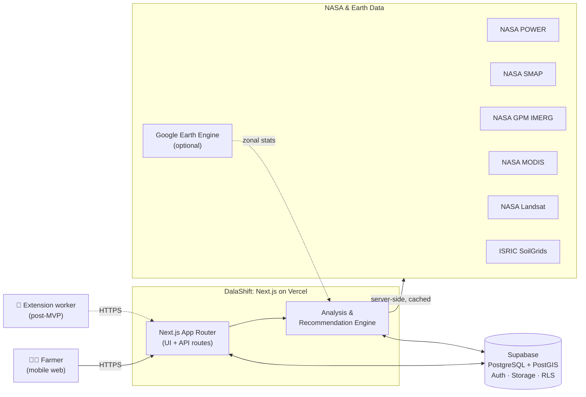

### 2.2 The layered reality of the application

There is no separate "backend". The Next.js server is the backend. The layers
exist as directories, not as processes.

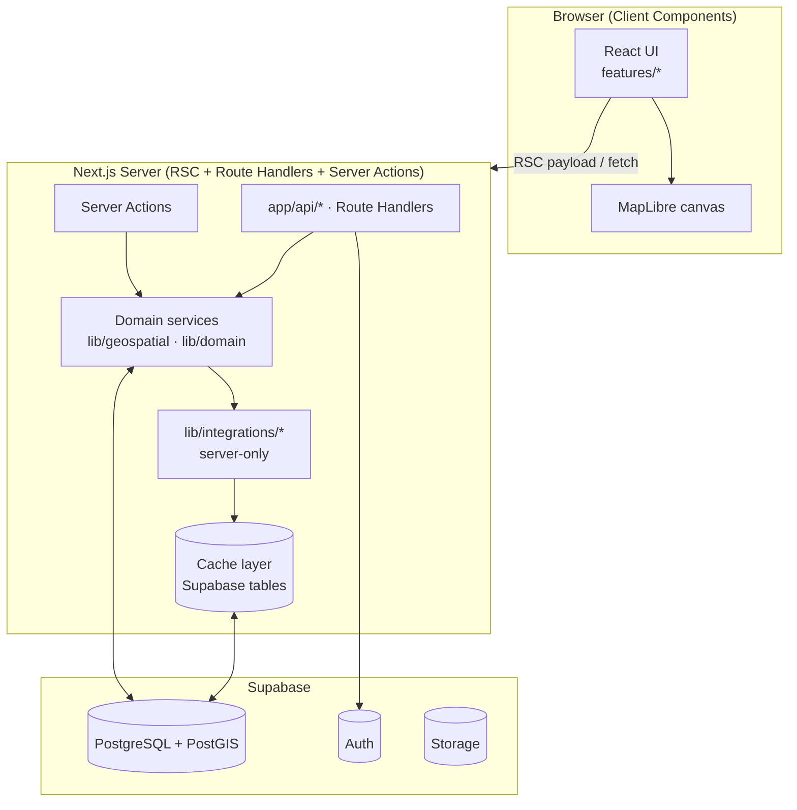

**Boundary rule:** `lib/integrations/**` is marked `import "server-only"`.
Importing it from a Client Component is a build error, not a runtime surprise.

---

## 3. Frontend architecture

### 3.1 Framework and routing

Next.js App Router (v16), React 19, TypeScript strict mode.

```mermaid
flowchart LR
    subgraph Public["(marketing): public"]
        L["/"]
        About["/about"]
        Method["/methodology"]
    end
    subgraph Auth["(auth): unauthenticated"]
        Login["/login"]
        Reg["/register"]
        CB["/auth/callback"]
    end
    subgraph Dash["(dashboard): authenticated, RLS-scoped"]
        Farms["/farms"]
        Farm["/farms/[farmId]"]
        FarmEnv["/farms/[farmId]/environment"]
        FarmRec["/farms/[farmId]/recommendations"]
        Reports["/reports"]
        Profile["/profile"]
    end
    API["/api/*: Route Handlers"]

    Public -.-> Auth -.-> Dash
    Dash --> API
```

Route groups (`(marketing)`, `(auth)`, `(dashboard)`) organise code without
affecting the URL. `(dashboard)` is protected by middleware plus RLS; the
middleware is a UX shortcut, **RLS is the actual boundary**.

### 3.2 Component organisation

| Layer                | Location                         | Rule                                                        |
| -------------------- | -------------------------------- | ----------------------------------------------------------- |
| Primitives           | `components/ui/`                 | shadcn/ui. Generated by the CLI. Do not hand-edit.          |
| Shared presentational| `components/{layout,dashboard,farms,maps,charts,forms}/` | Stateless or presentational. No data fetching. |
| Feature slices      | `features/<name>/`               | Owns UI + hooks + server actions for one domain area.        |
| Composition root    | `app/(dashboard)/layout.tsx`     | Shell, navigation, session context.                          |

**Feature slices do not import each other's internals.** A shared concept
moves to `packages/shared` (types, schemas, constants) or is read through the
database. This keeps three people from colliding on the same files during the
hackathon.

### 3.3 State and data fetching

| Data class                     | Mechanism                                                     |
| ------------------------------ | ------------------------------------------------------------- |
| Session / user                 | Supabase Auth session, read server-side in RSC.               |
| Farm, crop, profile data       | Direct Supabase client queries from RSC/server actions, with RLS enforcing ownership. |
| Environmental observations     | Server-side fetch → Supabase cache → RSC render. Never from the client. |
| Map interaction state          | Client state (React) inside the map feature.                  |
| Form state                     | React Hook Form + Zod resolver.                              |

**Rule:** the browser may read the database **directly through the anon key**,
but only for data the RLS policies allow, and only through
`lib/supabase/client.ts`. The browser never calls NASA.

### 3.4 Map architecture

- **MapLibre GL JS** for rendering. **Terra Draw** (or `maplibre-gl-draw`) for
  polygon drawing. Both are MapLibre-native; `@mapbox/mapbox-gl-draw` requires
  compatibility shims and is avoided.
- The basemap style is a runtime configuration (`NEXT_PUBLIC_MAP_STYLE_URL`),
  not hardcoded: this lets the team switch providers (and fall back) without
  a code change. See `docs/api/map-tile-providers.md` for provider options,
  attribution obligations and usage policies.
- Farm polygons render from PostGIS as GeoJSON via a server component or
  route handler.
- **Area preview** is computed client-side with Turf for immediate feedback
  while drawing, then **confirmed server-side with PostGIS `ST_Area`** on save.
  The PostGIS value is authoritative; the client value is a preview.
- **Geocoding/search** for place names is a separate, optional integration
  (Nominatim or a provider key). It is optional by design: the primary flow is
  "pan and draw", which must work even if the geocoder is unavailable or
  rate-limited.

### 3.5 Design system

Tailwind CSS v4 + shadcn/ui, with the token set in
`apps/web/src/app/globals.css`. The design phase must define the visual
direction in `docs/design/`. The current token set is deliberately neutral:
no brand colour is asserted before the team confirms the direction.

---

## 4. Backend architecture

### 4.1 Why there is no separate backend

The brief is explicit, and the reasoning holds: for an MVP of this size, a
separate API service adds deployment, networking, authentication duplication
and CORS configuration without removing a single problem. Next.js Route
Handlers and Server Actions run as serverless functions on Vercel and can do
everything a small API would.

**Trigger conditions for splitting** (documented here so the decision is not
made under pressure):

1. A workload requires long-running jobs exceeding Vercel's function timeout
   (> 60s on Pro, 300s on Enterprise), e.g. raster zonal statistics over
   many farms.
2. The integration layer needs to run on a schedule independent of user
   traffic (bulk refresh of many farms).
3. Third parties need a stable, versioned public API with different
   authentication from the web app.
4. Vercel function invocations or bandwidth costs exceed the budget.

If any of these is reached, the natural extraction is the **integration and
processing layer** (a worker), keeping the Next.js app as the web/API tier,
not a rewrite.

### 4.2 Server-side module boundaries

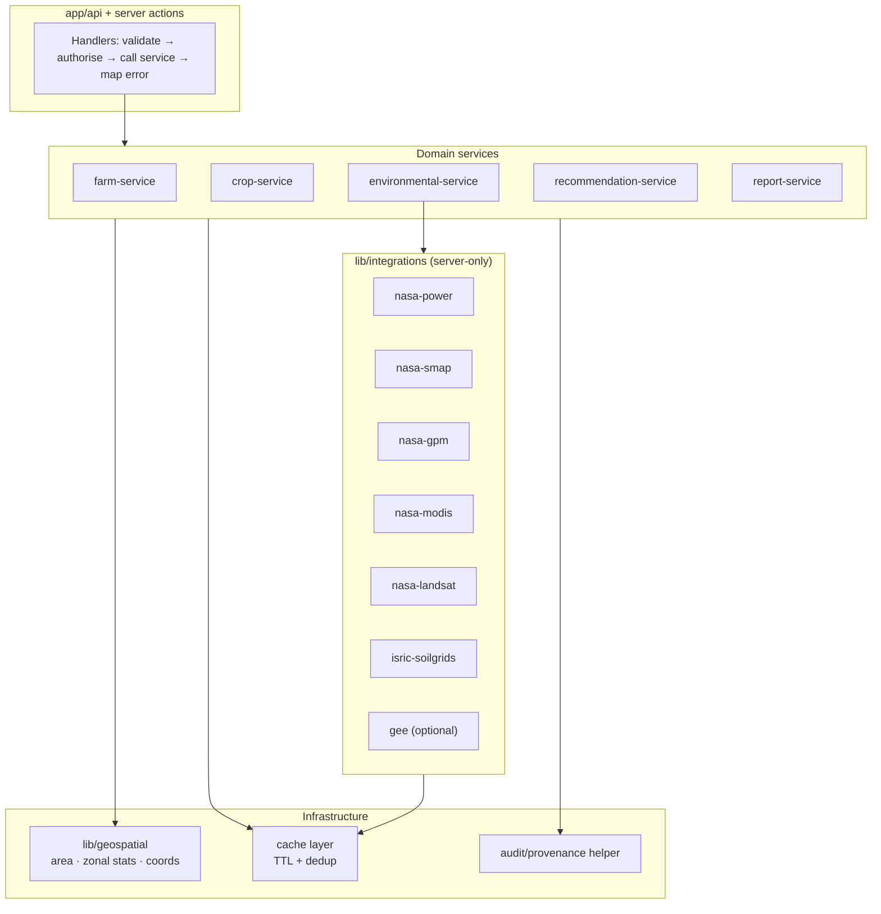

Each integration module has the same contract:

| Contract element     | Responsibility                                                  |
| -------------------- | --------------------------------------------------------------- |
| `fetch*` functions   | Return a typed, validated, normalised domain value. Never a raw upstream payload. |
| Provenance           | Every returned value carries `sourceId`, `spatialResolutionM`, `temporalResolution`, `observedAt`, `retrievedAt`, `isModelled`. |
| Timeouts + retries   | Explicit timeout; bounded retries with backoff; no infinite retry. |
| Rate limiting        | Respect the provider's documented limits; back off rather than hammer. |
| Normalisation        | Convert to canonical units (°C, mm, m³/m³, dimensionless NDVI) and canonical time (UTC). |
| Errors               | Typed error classes; a failed upstream never becomes a fabricated value. |

### 4.3 Caching

| Layer                       | Mechanism                                                       | Why                                                     |
| --------------------------- | --------------------------------------------------------------- | ------------------------------------------------------- |
| Request de-duplication      | In-process map keyed by `(source, variable, geometry, window)` | Prevents the same upstream call firing twice concurrently |
| Durable cache               | `environmental_observations` + `external_cache` tables         | Survives serverless cold starts; observable and evictable |
| Static reference data       | `data_sources`, `crops`, `recommendation_rulesets` tables     | Changes rarely; query them                                |
| Map tiles                   | Provider CDN (or self-hosted)                                   | Never proxied through the app                             |

**Cache TTL policy [Proposed]:**

| Data class                  | TTL                       | Reason                                                     |
| --------------------------- | ------------------------- | ---------------------------------------------------------- |
| POWER climatology           | Never expires             | Multi-year baseline is stable                              |
| POWER daily/monthly        | 1 day for recent, permanent for closed periods | Historical data does not change                |
| CHIRPS / GPM final precipitation | Permanent for closed periods; 1 day for the last few | Final runs are revised; late runs are provisional |
| SMAP soil moisture          | 7 days                    | Near-real-time product, but not needed hourly for our use  |
| MODIS NDVI (16-day composite) | 20 days                  | The composite period itself is the refresh interval        |
| Landsat                     | Permanent for closed scenes | Scenes are immutable                                       |
| SoilGrids                   | Never expires             | Static soil maps                                            |

**Staleness is surfaced, not hidden.** A cached value retains its observation
date, and the interface distinguishes "as of 3 days ago" from "current".

---

## 5. Database architecture

### 5.1 Platform

Supabase = managed PostgreSQL with PostGIS, Auth, Storage and Row Level
Security. The team owns the schema through versioned migrations in
`supabase/migrations/`; the Supabase dashboard is not used to create tables.

### 5.2 Entity model

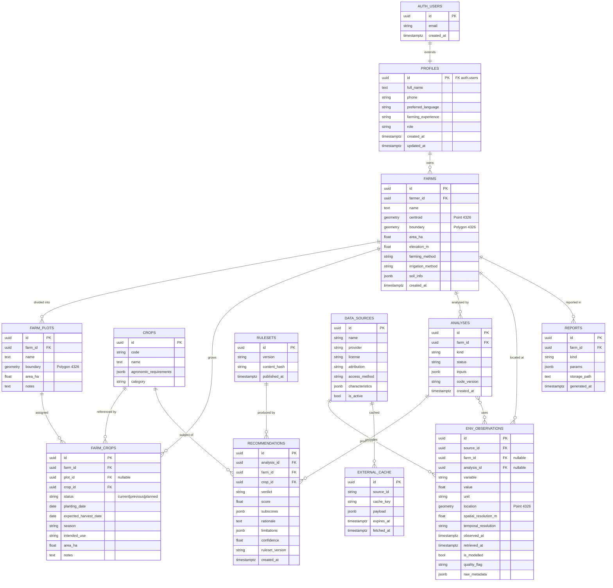

> The full column-level design, constraints, indexes and RLS policies are in
> `docs/database/data-model.md` and `docs/database/rls-policies.md`.

### 5.3 Geospatial storage

| Concern             | Decision                                                                       |
| ------------------- | ------------------------------------------------------------------------------ |
| SRID                | 4326 (WGS 84) for all stored geometry.                                         |
| Geometry types      | `POINT` for centroid and observation locations; `POLYGON` (with `MULTIPOLYGON` allowance) for farm and plot boundaries. |
| Area computation    | `ST_Area(boundary::geography)`: spherical, correct on a real earth, in m². `ST_Area` on the projected geometry returns degrees² and is wrong. |
| Crop-area fractions | `ST_Area(ST_Intersection(farm_boundary, plot_boundary)::geography)` for plots overlapping the farm. |
| Containment        | `ST_Contains` / `ST_Intersects` against a `GIST` index.                        |
| Validation          | `ST_IsValid`, `ST_MakeValid`, and a check that the polygon's area is within a sane range. |
| Coordinate order    | GeoJSON is `(lng, lat)`. PostGIS 4326 is `(lat, lng)`. **This is a classic bug source: normalise at the boundary and test it.** |
| Snapshots           | A farm boundary change creates a new geometry and re-runs affected analyses; prior analyses retain their input snapshot. |

### 5.4 Indexing strategy

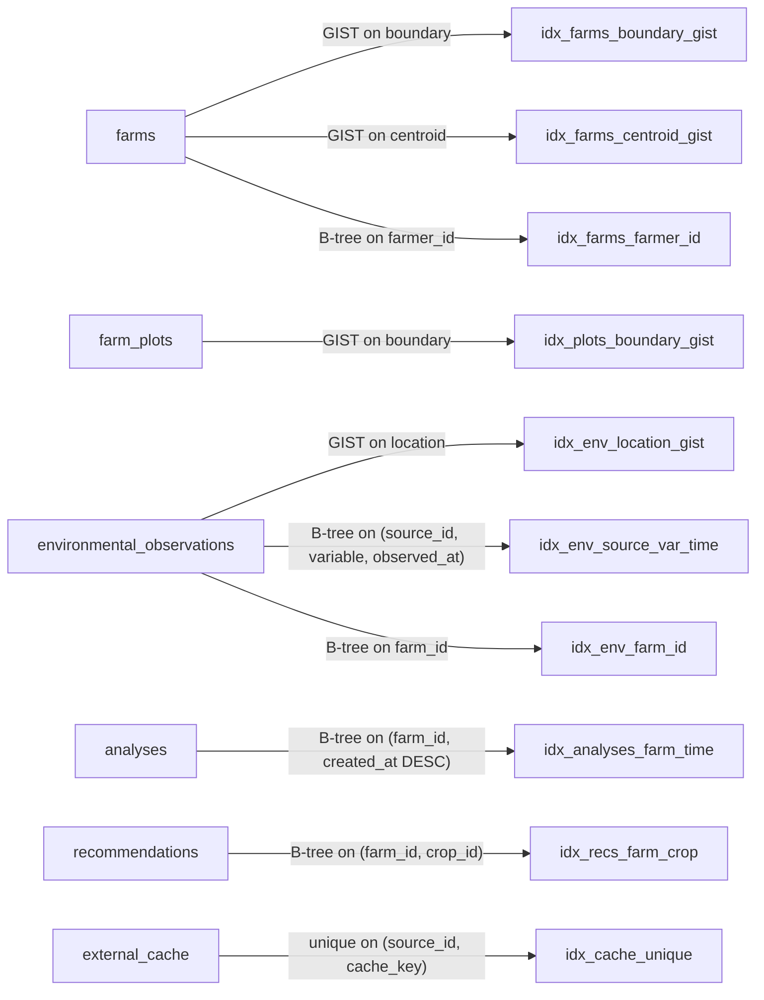

---

## 6. Geospatial architecture

### 6.1 The resolution ladder

This table is the single most important reference in the project. **Copy the
real numbers into the product, not the source names.**

| Product                     | Typical spatial resolution | Temporal        | What one "value" actually covers                         |
| --------------------------- | -------------------------- | --------------- | -------------------------------------------------------- |
| NASA POWER (gridded)        | ~0.5° × 0.625° (≈ 55 × 70 km) | daily / monthly / climatology | A regional climate cell, containing many thousands of farms |
| NASA SMAP L3 soil moisture  | 9 km (36 km enhanced)      | ~3-hour overpass | A neighbourhood-scale wetness indicator                   |
| NASA GPM IMERG              | 0.1° (≈ 11 km)             | 30-minute       | Sub-daily rainfall over an 11 km cell                    |
| CHIRPS                      | 0.05° (≈ 5.5 km)           | daily           | Daily rainfall over a 5.5 km cell                       |
| ISRIC SoilGrids            | 250 m (also 1 km, 5 km)    | static          | A soil property interpolated to a 250 m cell             |
| NASA MODIS NDVI/EVI         | 250 m (MOD13Q1) / 1 km (MOD13A2) | 16-day composite | Vegetation condition over the composite period      |
| NASA MODIS land surface temp | 1 km                        | daily           | Day/night surface temperature over a 1 km cell           |
| NASA Landsat (Collection 2) | 30 m                        | 16-day revisit  | Surface reflectance over the scene                       |

### 6.2 Aggregation strategy by source

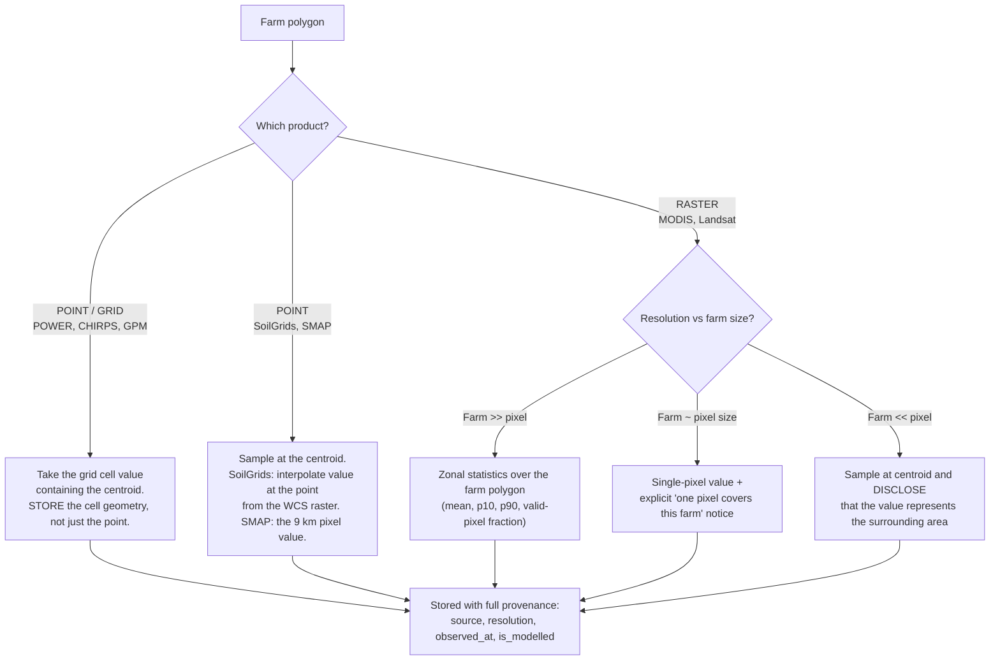

**Rules that follow from this diagram:**

- **Zonal statistics are computed server-side**, in PostGIS where possible
  (vector intersection) or via the raster API where the source is raster-native.
- **The valid-pixel fraction is stored.** If 40% of a farm polygon falls over
  cloud or a data gap, the interface says so, and confidence drops.
- **A farm smaller than the pixel is never described as "measured on your
  farm."** The UI distinguishes "measured over your farm" (zonal), "nearest
  pixel value" (sampled), and "estimated" (interpolated/modelled).
- **Interpolation is only used where the source provides it** (SoilGrids
  WCS interpolation, MODIS gap-filled products). DalaShift does not invent
  spatial detail the source does not have.

### 6.3 Where the computation happens

| Operation                                    | Where                          | Why                                                        |
| -------------------------------------------- | ------------------------------ | ---------------------------------------------------------- |
| Farm area, plot area, intersection area      | PostGIS (`ST_Area` geography)  | Authoritative, consistent, index-friendly                  |
| Point-in-polygon, nearest farm                | PostGIS (`ST_Contains`)         | Index-accelerated                                           |
| Grid-cell lookup (POWER, CHIRPS, GPM)        | PostGIS join against a grid reference table | Cheap, cached                        |
| Zonal statistics over a raster (MODIS, Landsat)| Raster API (GEE) or pre-computed tiles | Rasters do not belong in PostgreSQL                |
| Coordinate formatting, GeoJSON conversion     | Application (`lib/geospatial`) | Pure functions, easy to unit test                          |
| Client-side area preview while drawing       | Turf (browser)                 | Immediate feedback; PostGIS value wins on save             |

### 6.4 Raster handling: the explicit non-goal

**[Confirmed]** Large raw satellite raster datasets must not be stored in
PostgreSQL and must not be committed to Git.

**Storage strategy for rasters:**

| Approach                              | When to use                                                     | Assessment for the MVP                       |
| ------------------------------------- | ---------------------------------------------------------------- | -------------------------------------------- |
| **Query the provider's API / GEE**   | Where an on-the-fly service exists (MODIS/Landsat via GEE)      | **Recommended.** No storage, no pipeline.      |
| **Pre-compute zonal stats on demand** | Where the farm's value can be computed once and cached           | **Recommended.** Cheap, cacheable, auditable. |
| **Store tiles in object storage**     | Where a tile server is needed for map display                     | Optional; e.g. COG + a tile service           |
| **Store rasters in Postgres**        | Never                                                           | **Prohibited.** Blob bloat, slow backups.     |

Pre-computed zonal statistics are cached in `environmental_observations` with
their provenance, so a repeated view of a farm costs nothing.

---

## 7. External API integration architecture

### 7.1 Integration registry

Every external source is registered in `docs/api/data-sources.md` and mirrored
as rows in the `data_sources` table. The table is the runtime index; the
document is the human-readable record. The full research is in
`docs/api/`.

### 7.2 Access tiers

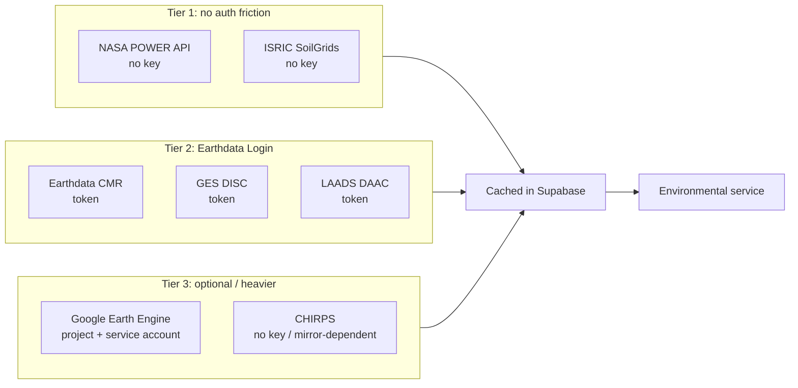

**Tier 1 is the MVP path.** POWER and SoilGrids cover a large share of what
the product needs with no authentication setup. That is a deliberate risk
reduction for a 48-hour build: the demo must not depend on an account
approval landing in time.

### 7.3 Failure handling for upstreams

| Failure                        | Behaviour                                                        |
| ------------------------------ | ---------------------------------------------------------------- |
| Upstream 5xx / timeout        | Retry with exponential backoff (max 2). Then return a typed error. |
| Upstream 429                   | Respect `Retry-After`. Do not retry immediately. Cache the error briefly to avoid hammering. |
| Upstream 404 (no data)         | **Not an error.** Record a "no data available" observation for the period, and let the analysis report the gap. |
| Partial coverage               | Store the valid-pixel fraction; confidence drops.                 |
| Auth failure (401/403)         | Typed error → surfaced to the operator, never to the farmer as a technical message. |
| All sources unavailable         | The farm still renders. The panel shows what is available and states what could not be retrieved. |

**The last row is the important one.** A farmer's farm registration, crop
records and previously cached analysis must remain usable when an upstream is
down. The demo should degrade, not collapse.

### 7.4 Data provenance record

Every integration returns values shaped like:

```ts
interface ProvenancedValue {
  variable: string;          // canonical variable id, e.g. "precipitation_mm"
  value: number;
  unit: string;              // canonical unit
  sourceId: string;          // FK → data_sources
  spatialResolutionM: number;
  temporalResolution: string; // e.g. "daily", "16-day", "monthly"
  observedAt: string;         // ISO 8601, UTC
  retrievedAt: string;        // ISO 8601, UTC
  isModelled: boolean;
  qualityFlag?: "good" | "suspect" | "missing" | "partial";
  coverageFraction?: number;  // fraction of the geometry with valid data
  rawMetadata?: Record<string, unknown>; // source-specific, for audit
}
```

`rawMetadata` is stored as `jsonb` so that a source's original identifiers
(the POWER parameter name, the GEE image ID, the SMAP granule) survive into
the audit trail.

---

## 8. Data ingestion and processing

Two modes. Both are needed.

```mermaid
flowchart TB
    subgraph OnDemand["On-demand (user-triggered)"]
        U["Farmer opens farm / requests analysis"] --> V["Validate + authorise"]
        V --> K["Build cache key<br/>(source, variable, geometry, window)"]
        K --> C{"Cache hit?"}
        C -->|Yes| R["Return cached values"]
        C -->|No| F["Call upstream"]
        F --> N["Normalise + attach provenance"]
        N --> S["Store in external_cache + environmental_observations"]
        S --> R
    end

    subgraph Batch["Scheduled refresh (background)"]
        T["Cron trigger → refresh endpoint"] --> L["List farms with stale analysis"]
        L --> F2["Call upstream for stale farms"]
        F2 --> N2["Normalise + update observations"]
        N2 --> M["Recompute affected analyses"]
        M --> A["Append to analysis history"]
    end
```

**Trigger mechanism [Proposed].** Vercel Cron is the simplest option but its
frequency limits depend on the plan; the Hobby plan allows daily crons only.
Options, in order of preference:

1. **Vercel Cron**: simplest; adequate if daily refresh is enough.
2. **GitHub Actions scheduled workflow**: calls a protected refresh endpoint.
   Flexible frequency, but adds a secret and an auth handshake.
3. **Supabase `pg_cron` + Edge Function**: keeps it inside the platform.
   Requires the Supabase Pro plan for `pg_cron`.

For a 48-hour MVP, on-demand plus a manual "Refresh" button is sufficient;
the scheduled refresh is a Phase 3 concern. **Do not build the batch pipeline
during the hackathon unless the demo needs it.**

### 8.1 Pre-computation

Anything computable ahead of time should be computed ahead of time:

| Pre-computed artifact                              | Why                                              |
| -------------------------------------------------- | ------------------------------------------------ |
| POWER climatology for the validation region        | Stable; enables instant anomaly comparison        |
| SoilGrids values for the validation region         | Static; avoids repeated raster interpolation      |
| A demo farm fixture set                            | Makes the demo independent of network conditions   |

---

## 9. Recommendation system architecture

### 9.1 Design

The recommendation engine is a **deterministic, versioned, rule-based
evaluator**. This is a deliberate choice, not a simplification:

| Requirement                          | Why a rules engine wins                                                                 |
| ------------------------------------ | --------------------------------------------------------------------------------------- |
| Explainability                       | Every verdict traces to named inputs and a named rule. A model cannot do this reliably.   |
| Auditability for a hackathon        | A judge can inspect the rules.                                                           |
| Correctability by the team in hours  | A wrong agronomic threshold is a one-line fix. Fine-tuning is not.                       |
| Determinism                          | The same inputs always give the same answer (NFR-H5).                                     |
| No hallucinated agronomy             | The engine cannot invent a crop requirement.                                             |
| Constraints are expressible          | "Soil pH below 5.0 excludes maize" is a hard constraint, trivially encoded.               |

**Where an LLM may be used [Proposed, optional]:** rewriting the engine's
output into plain language for a farmer. It receives the engine's structured
output and may only paraphrase it. It may not add a number, a verdict, or an
agronomic claim. If the LLM is unavailable, the structured output renders
directly. **This is a strict boundary and should be enforced structurally, not
by convention**: see § 9.4.

### 9.2 The three information categories

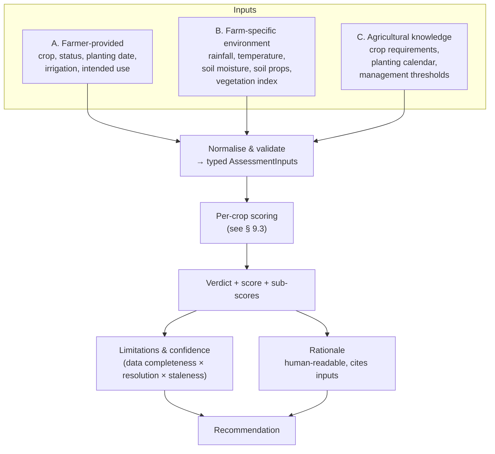

### 9.3 Scoring model

**[Proposed]**: the exact thresholds require agricultural review and are not
fixed in Phase 1. The *structure* is fixed.

**Hard constraints** (any failure ⇒ not suitable, regardless of score):

| Constraint              | Example source of truth              |
| ----------------------- | ------------------------------------ |
| Soil pH outside range   | SoilGrids + crop requirement catalog |
| Annual rainfall below minimum | POWER/CHIRPS climatology         |
| Temperature outside range | POWER climatology                   |
| Growing season length insufficient | POWER climatology + crop calendar |

**Scored dimensions** (each 0 to 1, then weighted):

| Dimension            | Meaning                                                       |
| -------------------- | ------------------------------------------------------------- |
| Climate match        | Rainfall and temperature against the crop's requirement band  |
| Season timing        | Does the planting window align with the local rainy-season onset? |
| Water availability    | Rainfall + irrigation method vs. crop water demand             |
| Soil match           | SoilGrids texture, pH and organic carbon vs. crop preference    |
| Vegetation condition  | Current NDVI/EVI relative to the crop's expected stage          |
| Risk                 | Drought/flood/heat exposure over the relevant period           |

**Confidence** is computed separately from the score. A high score with poor
data is not a high-confidence answer.

```
confidence = data_completeness × resolution_factor × recency_factor × constraint_certainty
```

A recommendation therefore carries a verdict (`suitable` / `conditional` /
`not_suitable` / `insufficient_information`), a score, per-dimension
sub-scores, a rationale, an explicit limitations list, and a confidence
value, with the ruleset version that produced it.

### 9.4 Enforcing the LLM boundary

**[Proposed]** Structural enforcement, not convention:

1. The engine returns a structured `Recommendation` object.
2. The LLM prompt receives only that object's fields and a strict instruction
   to paraphrase. It has **no tools and no data access**.
3. The output is validated against a schema that **cannot express a new
   number or verdict**, only prose.
4. If validation fails, the raw structured output is shown instead.
5. A unit test asserts that the LLM path cannot change `verdict`, `score` or
   `confidence`.

### 9.5 The agricultural knowledge base

**[Proposed]** Crop requirements live in a **versioned reference catalog in
the repository** (JSON/TypeScript, seeded into a `crops` table), not fetched
from an API at runtime. Why:

- It is auditable and diffable: a judge can read the requirements for millet.
- It works offline, so the demo does not depend on a third-party catalog API.
- It can be corrected in minutes during the hackathon.

Each crop entry carries: agronomic requirements (temperature range, rainfall
range, growing-period length, soil pH/texture/drainage preference, water
demand), planting window, and the **source citation** for each requirement.
**Every value in the catalog must cite a source.** An uncited requirement is a
defect.

### 9.6 Handling insufficient information

**[Confirmed]** When information is insufficient, the platform must communicate
the limitation rather than inventing an answer.

Concretely, the engine emits `insufficient_information` when, for example:
the environment has no rainfall record for the relevant period; the crop's
requirements are not in the catalog; the farm has no location; or the farmer
has not selected a crop *and* the suitability assessment lacks the soil or
climate data needed to discriminate between candidates.

In every case the response names **what is missing** and **what would fix
it**, e.g. "Soil pH is unavailable for this area, so I cannot confirm maize
is suitable. Adding your own note about the soil would let me check."

---

## 10. Authentication and authorization

### 10.1 Authentication

Supabase Auth. Email/password for the MVP. **[Open]** Whether to add OTP or
social login: deferred; it is a Phase 3 decision and does not affect the
architecture.

Sessions are cookie-based via `@supabase/ssr`, which keeps the token out of
client-side JavaScript and makes middleware checks possible.

### 10.2 Authorization model

| Role              | Own farms | Own profile | Read published reference data | Aggregated multi-farm view | Platform admin |
| ----------------- | --------- | ----------- | ----------------------------- | -------------------------- | -------------- |
| `farmer`          | ✔         | ✔           | ✔                             | ✘                          | ✘              |
| `extension_worker`| ✔ + assigned | ✔         | ✔                             | ✔ (assigned farms only)    | ✘              |
| `researcher`      | ✔         | ✔           | ✔                             | ✔ (de-identified aggregates)| ✘              |
| `admin`           | ✔         | ✔           | ✔                             | ✔                          | ✔              |

**[Confirmed]** The MVP is farmer-first. The other roles exist in the model
so that extension workers can be added without a schema change, but **no
non-farmer workflow is designed in the MVP**.

### 10.3 Enforcement

**RLS is the enforcement layer. Application checks are a UX convenience, not
the boundary.**

- Every farmer-scoped table has RLS policies keyed on `auth.uid()`.
- The anon key can only do what RLS permits: a forged request cannot read
  another farmer's farms.
- The service-role key bypasses RLS and is used only for: scheduled refresh
  jobs, and admin operations. It is never used to serve a user request
  directly.
- Route handlers that write verify the caller's identity before touching the
  service-role client.

### 10.4 Middleware

Next.js middleware performs an unauthenticated redirect for `(dashboard)`
routes and redirects authenticated users away from `(auth)` routes. This is a
**user-experience** measure. RLS remains the security boundary, so a bug in
middleware cannot leak data.

---

## 11. Data flow

### 11.1 Farm registration

```mermaid
sequenceDiagram
    actor F as Farmer
    participant UI as Map UI (client)
    participant R as Route Handler
    participant G as lib/geospatial
    participant DB as Supabase / PostGIS

    F->>UI: Draws boundary
    UI->>UI: Turf area preview (client, immediate)
    F->>UI: Names farm, submits
    UI->>R: POST /api/farms {name, geometry}
    R->>R: Zod validate
    R->>DB: Insert farm (row owner = auth.uid())
    DB->>DB: RLS check; ST_Area(boundary::geography) → area_ha
    R->>DB: Insert centroid from ST_Centroid
    R-->>UI: {farmId, areaHa, centroid}
    UI-->>F: Farm saved with confirmed area
```

Note the area is computed **by the database**, not trusted from the client.

### 11.2 Environmental analysis

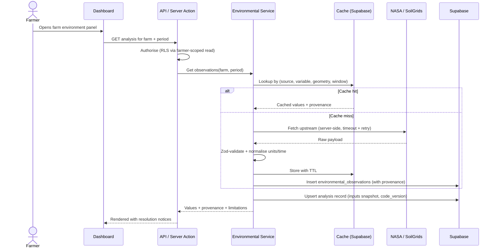

### 11.3 Recommendation

```mermaid
sequenceDiagram
    actor F as Farmer
    participant UI as Farm panel
    participant R as Server Action
    participant E as Recommendation Engine
    participant K as Crop catalog (DB)
    participant DB as Supabase

    F->>UI: Requests recommendations
    UI->>R: POST /api/farms/{id}/recommendations
    R->>E: Assess(farm, crops, observations)
    E->>DB: Read observations for farm + period
    E->>K: Read crop requirements (catalog)
    E->>E: Hard constraints → dimension scores → verdict
    E->>E: Compute confidence; enumerate limitations
    E->>DB: Insert recommendation (ruleset_version)
    E-->>R: {verdict, score, subscores, rationale, limitations, confidence}
    R-->>UI: Rendered
```

---

## 12. Storage strategy

| Data                       | Location                              | Rationale                                                    |
| -------------------------- | ------------------------------------- | ------------------------------------------------------------ |
| Farmer, farm, crop records | PostgreSQL (Supabase)                 | Relational, RLS, transactional                              |
| Farm and plot geometry     | PostGIS `geometry` columns            | Spatial indexing, authoritative area/intersection            |
| Environmental observations | PostgreSQL rows                       | Queryable, provenance-carrying, time-series friendly        |
| Cached upstream payloads   | `external_cache` (`jsonb`) + TTL      | Durable across serverless cold starts                        |
| Farm photographs/documents | Supabase Storage                      | Private buckets; served via signed URLs                       |
| Generated reports (PDF)    | Supabase Storage                      | Large blobs do not belong in the database                    |
| Raw rasters / tiles        | Object storage (if ever needed)       | Never in Postgres, never in Git                              |
| Reference catalog (crops)  | Versioned JSON in repo → seeded table | Auditable, diffable, correctable                              |
| Secrets                    | Vercel environment variables          | Never in the repo                                             |

### 12.1 Storage access rules

- Storage buckets are **private**. Files are served through signed URLs with a
  short expiry.
- Uploaded file types are validated and size-capped.
- A farmer can only access files under their own farm prefix.
- Generated reports are reproducible: the report is regenerated from stored
  data, not from a stale binary.

### 12.2 What is never stored

- Passwords (Supabase Auth holds them).
- Raw upstream payloads without normalisation and provenance.
- Farmer PII outside the profile table.
- Rasters in Postgres.
- Any secret, in any table.

---

## 13. Error handling

### 13.1 Error taxonomy

| Class                 | Example                                | User-facing behaviour                        | Operator signal                |
| --------------------- | -------------------------------------- | -------------------------------------------- | ------------------------------ |
| `ValidationError`     | Missing required field                 | Inline field errors                          | None                           |
| `UnauthorizedError`   | Not signed in; wrong owner             | Redirect to login / "not found"             | None                           |
| `NotFoundError`       | Unknown farm id                        | Empty state                                  | None                           |
| `UpstreamError`       | NASA returned 500                      | "Environmental data is temporarily unavailable" | Log with source + attempt    |
| `UpstreamTimeout`     | No response in N seconds               | Same as above, with retry guidance           | Log + alert if sustained      |
| `RateLimitError`      | 429 from the provider                  | "Data is being refreshed; try again shortly" | Log                           |
| `NoDataError`         | Valid response, no data for the period | "No data available for this period" + gap notice | Log at debug |
| `InternalError`       | Unexpected exception                   | Generic failure message                      | Log with stack trace           |

### 13.2 Principles

1. **Never fabricate a fallback value.** A missing upstream is a gap, not a
   zero. `NoDataError` is a first-class outcome, distinct from an error.
2. **Never leak internals.** Stack traces and provider payloads stay
   server-side. The farmer sees a sentence, not a stack trace.
3. **Partial results are valid.** Rainfall may be available while soil
   moisture is not. The panel renders what exists and names what does not.
4. **Fail soft at the analysis layer, hard at the transaction layer.** A
   failed environmental fetch must not roll back a successful farm save.
5. **Retries are bounded and observable.** Max two retries with exponential
   backoff, logged.

### 13.3 User-visible states

Every data view implements four states: **loading** (skeleton, not a spinner
over blank space), **empty** (explains what would appear and how to get it),
**error** (says what happened and what to do), **stale** (shows the
observation date and a refresh affordance).

---

## 14. Security architecture

See `SECURITY.md` for the full policy. Architectural controls:

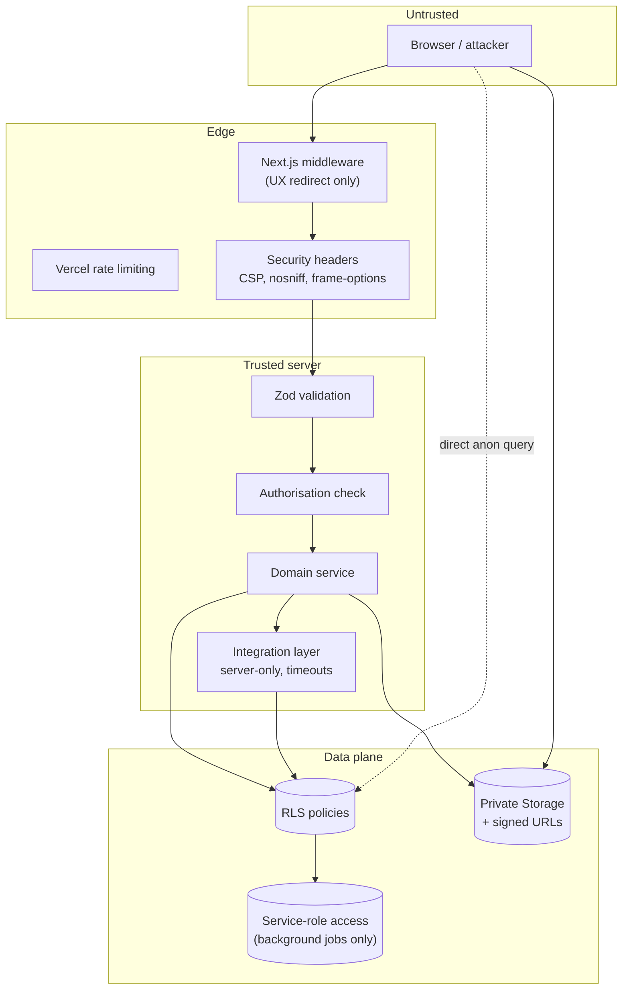

**Controls in summary:**

| Control                          | Implementation                                                    |
| -------------------------------- | ----------------------------------------------------------------- |
| Authentication                   | Supabase Auth, cookie sessions via `@supabase/ssr`                 |
| Authorization                    | PostgreSQL RLS on every farmer-scoped table                       |
| Secret isolation                 | `import "server-only"`; `SUPABASE_SERVICE_ROLE_KEY` never in client |
| Input validation                 | Zod at every route handler, server action and upstream response   |
| SQL injection                    | Parameterised queries / PostgREST filters only                    |
| Transport                        | HTTPS everywhere; `Referrer-Policy`, `X-Frame-Options`, `nosniff` |
| Rate limiting                    | On endpoints triggering upstream calls                             |
| Data protection at rest          | Supabase managed encryption; private Storage buckets              |
| Secret scanning                  | gitleaks in CI; `.gitignore` rules; `.env.example` placeholders only |
| Dependency hygiene               | Dependabot; `pnpm audit`                                         |
| CSP                              | **[Open]**: required before the demo loads any third-party script |

### 14.1 Threat considerations specific to this product

| Threat                          | Mitigation                                                             |
| ------------------------------- | ---------------------------------------------------------------------- |
| Service-role key leaks to client | `server-only` guard; `NEXT_PUBLIC_` review in PR checklist; gitleaks  |
| Cross-farmer data access        | RLS; tests that assert a second account cannot read the first's farm   |
| Upstream response injection     | Zod validation of every upstream payload; upstream never trusted        |
| Farm location privacy           | Coordinates are personal data; no public sharing of exact polygons; reports exclude full coordinates by default |
| Scraping of farmer data         | Rate limiting; no enumeration endpoints; opaque IDs where practical    |
| Over-broad storage access       | Private buckets; signed URLs; per-user path prefixes                    |
| Licence violation via data use  | Attribution registry; per-source attribution rendered in-product        |

---

## 15. Deployment architecture

### 15.1 Target topology

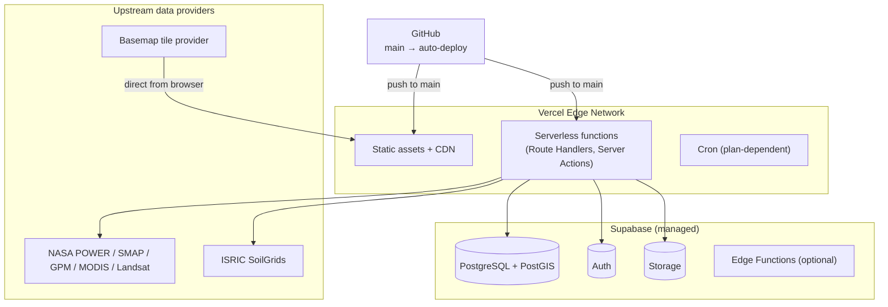

### 15.2 Environments

| Environment | Purpose                        | Data                                   | External APIs      |
| ----------- | ------------------------------ | -------------------------------------- | ------------------ |
| `local`     | Development                    | Supabase local or a dev project       | Real, but rate-limited |
| `preview`   | Per-pull-request               | Separate Supabase project              | Real, minimal calls |
| `production`| The demo / deployment          | Production Supabase project            | Real               |

**Preview deployments matter more than usual here.** They let the three
teammates test a branch without touching the demo data.

### 15.3 Deployment flow

1. Push to a feature branch → Vercel creates a **Preview** deployment.
2. Open a PR → CI runs format, lint, typecheck, test, secret scan.
3. Merge to `main` → Vercel creates a **Production** deployment.
4. Schema changes are applied by running the migration script against the
   target Supabase project **before** the deployment that depends on them.

### 15.4 Migration strategy

- SQL migrations live in `supabase/migrations/<timestamp>_<name>.sql`.
- Applied in order by a documented command (Supabase CLI `db push`, or a
  documented `psql` invocation).
- **Phase 1 contains no migrations.** The schema is specified in
  `docs/database/data-model.md` and written in Phase 2.
- Migrations are reviewed like code. A destructive change to a farmer-scoped
  table requires an explicit note in the PR description and a backup plan.

---

## 16. Scalability considerations

### 16.1 Where the bottlenecks will be

| Bottleneck                        | Cause                                               | Mitigation                                              |
| --------------------------------- | --------------------------------------------------- | ------------------------------------------------------- |
| Upstream API latency and quota    | Every farm analysis is an external call              | Cache aggressively; pre-compute; batch refresh           |
| Zonal statistics over rasters     | Raster processing is CPU-bound                       | GEE on-the-fly, or pre-compute and cache               |
| Connection pool                  | Serverless functions + Supabase pooler               | Supabase transaction pooler (Pool mode); keep functions short |
| Storage growth                    | Every observation row per farm per variable per period | Retention policy; partition by time if needed        |
| Map rendering on mobile           | Large GeoJSON, many polygons                         | Simplify geometries server-side; viewport-based loading  |

### 16.2 Scaling characteristics

| Dimension         | Current (MVP)          | Growth path                                                 |
| ----------------- | ---------------------- | ------------------------------------------------------------ |
| Users             | Tens                  | Supabase scales; no change needed                            |
| Farms per user    | 1 to 10                 | No change needed                                             |
| Farms total       | Hundreds               | Cache hit rate does the work                                 |
| Observations      | ~10³ to 10⁵ rows       | Partition `environmental_observations` by `observed_at`       |
| Concurrent users  | Low                   | Vercel autoscales                                           |
| Analysis jobs     | Ad hoc                 | Move to a queue + worker if sustained (see § 4.1)           |

### 16.3 Deliberate non-optimisations

The MVP deliberately avoids premature scale work. Listed so nobody adds it
during the hackathon:

- No message queue, no event bus, no microservices.
- No Redis. The Supabase cache table is sufficient at MVP volume.
- No read replicas, no partitioning.
- No Kubernetes, no containers, no Docker.
- No GraphQL. Server Components and Route Handlers cover the use cases.

---

## 17. Technical risks and trade-offs

### 17.1 Accepted trade-offs

| Decision                          | Trade-off accepted                                                          | When to revisit             |
| --------------------------------- | ----------------------------------------------------------------------------- | --------------------------- |
| One Next.js app, no backend service | Simpler deployment; less isolation. Heavy CPU jobs block the request path.   | A background job exceeds the function timeout |
| PostGIS for all spatial work       | Adds a PostGIS dependency and a migration path; slower than in-memory JS for tiny queries. | Never: PostGIS is the right call |
| Rules engine, not ML              | Less "impressive"; far more explainable and correctable.                      | If validated labelled data becomes available |
| Cache in the database              | Writes to the same DB as the product data; some query contention.            | Cache write volume threatens farm-data performance |
| Versioned catalog in the repo     | Requires a seed step and a deploy to change crop requirements.               | If a maintained external catalog with a stable API becomes available |
| Farm boundary required            | Adds a difficult step to onboarding (draw on a map).                         | If field testing shows farmers cannot draw: add an assisted path |
| Raster zonal stats via GEE        | Adds a GEE dependency, quota and a project setup burden.                     | If GEE access cannot be obtained: fall back to pre-computed tiles |

### 17.2 Open technical risks

| ID   | Risk                                                                  | Impact | Mitigation / status                                                          |
| ---- | --------------------------------------------------------------------- | ------ | ---------------------------------------------------------------------------- |
| TR-1 | **Earthdata account approval is slow**                                 | High   | MVP path uses no-auth sources (POWER, SoilGrids). Verify access on day 1 of Phase 2. |
| TR-2 | **GEE setup and quota prove impractical in 48h**                      | High   | GEE is optional, not load-bearing. Fallback: pre-computed zonal statistics.  |
| TR-3 | **Basemap provider rate-limits or blocks the demo**                  | High   | Provider is configuration, not code. Keep a fallback style and pre-warmed tiles. |
| TR-4 | **Farmers cannot draw an accurate polygon**                           | High   | Provide centroid-plus-radius fallback and a manual correction path. Validate in Tofa. |
| TR-5 | **Coarse resolution cannot support a genuinely farm-specific claim**  | High   | Design for it: zonal statistics, coverage fractions, explicit limitations. This is the core product risk, not an engineering risk. |
| TR-6 | **Crop catalog requirements are wrong for local practice**            | High   | Cite every requirement; validate against Tofa farmers; keep confidence conservative; show the source. |
| TR-7 | **Local planting calendars are missing or unreliable**               | Medium | Use POWER-derived rainy-season onset plus a cited calendar, and label which was used. |
| TR-8 | **Vercel serverless cold starts make the demo slow**                  | Medium | Cache in Supabase; warm the demo path before presenting.                 |
| TR-9 | **Vercel cron frequency limits prevent timely refresh**               | Low    | On-demand refresh plus manual refresh button for the MVP.                  |
| TR-10| **3-person team parallelism collides on shared files**                | Medium | File-ownership split in `CONTRIBUTING.md`; shared types frozen early.      |
| TR-11| **Field connectivity in Tofa is poor during validation**               | Medium | Offline-capable app shell; paper fallback for interviews; pre-seeded fixtures. |
| TR-12| **Open-source licence not yet chosen**                                | Medium | Blocks submission compliance. Tracked in ADR-0001. Must be resolved before submission. |

### 17.3 The risk that matters most

**TR-5 deserves the team's attention.**

A 9 km soil-moisture pixel over a 1.4 ha field is 800 hectares of information
about 1.4 hectares of land. The product must not pretend otherwise. The
architecture supports this (zonal statistics, coverage fractions, mandatory
provenance, explicit limitation strings, confidence decay), but the *content*
still has to be honest and the *interface* still has to make the caveat
impossible to miss.

The honest version of this product is still valuable: "rainfall over your
district this season is 15% below the 30-year average for this cell, and
your field's vegetation index is tracking at the low end of its neighbours,
consider planting later" is genuinely useful. The dishonest version ("your
farm's soil moisture is 18%") is not, and it is the version that is easiest
to build by accident.

---

## 18. Architecture decision index

All architecture decisions are recorded as ADRs in `docs/decisions/`. The
decision index below is a summary; **the ADR is the source of truth.**

| ADR                                    | Title                                      | Status   |
| -------------------------------------- | ------------------------------------------ | -------- |
| [ADR-0001](docs/decisions/ADR-0001-open-source-license.md) | Open-source license                | **Open** |
| [ADR-0002](docs/decisions/ADR-0002-monorepo-and-tooling.md) | Monorepo structure and tooling  | Accepted |
| [ADR-0003](docs/decisions/ADR-0003-supabase-postgis-as-data-platform.md) | Supabase + PostGIS as the data platform | Accepted |
| [ADR-0004](docs/decisions/ADR-0004-rules-based-recommendation-engine.md) | Rules-based recommendation engine | Accepted |
| [ADR-0005](docs/decisions/ADR-0005-geospatial-resolution-and-aggregation-strategy.md) | Geospatial resolution and aggregation strategy | Accepted |
| [ADR-0006](docs/decisions/ADR-0006-data-retention-and-consent.md) | Data retention and consent | **Open** |
| [ADR-0007](docs/decisions/ADR-0007-map-tile-provider.md) | Map tile provider strategy | **Open** |
| [ADR-0008](docs/decisions/ADR-0008-google-earth-engine-dependency.md) | Google Earth Engine as an optional dependency | **Open** |
| [ADR-0009](docs/decisions/ADR-0009-repository-visibility.md) | Repository visibility | **Open** |

---

## 19. Phase 2 implementation sequence

**[Proposed]**: a build order that front-loads the risky parts.

| Step | Deliverable                                              | Depends on |
| ---- | -------------------------------------------------------- | ---------- |
| 1    | Supabase project, PostGIS enabled, migrations, RLS        | None       |
| 2    | Auth: sign-up, sign-in, session, dashboard shell          | 1          |
| 3    | `lib/integrations` for POWER + SoilGrids, with cache      | 1          |
| 4    | Farm CRUD + polygon drawing + area computation            | 1, 2       |
| 5    | Crop records + plots                                       | 1, 2       |
| 6    | Environmental service + dashboard panels with provenance   | 3, 4       |
| 7    | Crop catalog + rules engine + recommendation UI           | 5, 6       |
| 8    | Suitability assessment for prospective farmers             | 7          |
| 9    | Reports                                                    | 7          |
| 10   | Time series / monitoring                                   | 6          |
| 11   | Polish, accessibility pass, demo data seeding              | all        |

Steps 3 and 4 are the risky ones and should be done **first**, because they
carry the authentication and the geospatial uncertainty. A polished UI built
on top of a broken integration is worthless.

---

## 20. Related documentation

| Document                                             | Purpose                                  |
| ---------------------------------------------------- | ---------------------------------------- |
| [`ARCHITECTURE_ESSENTIALS.md`](./ARCHITECTURE_ESSENTIALS.md) | Condensed reference for daily use  |
| [`AGENTS.md`](./AGENTS.md)                            | Rules for AI agents and contributors    |
| [`PRD.md`](./PRD.md)                                  | Product requirements                    |
| [`CONTRIBUTING.md`](./CONTRIBUTING.md)                | Workflow                                |
| [`SECURITY.md`](./SECURITY.md)                        | Security policy                         |
| [`docs/api/`](docs/api/)                              | Data source research and integration    |
| [`docs/database/`](docs/database/)                    | Schema, RLS, geospatial design           |
| [`docs/product/`](docs/product/)                      | Flows, recommendation methodology        |
| [`docs/design/`](docs/design/)                        | Visual direction and design system      |
| [`docs/research/`](docs/research/)                    | Background research                     |
| [`docs/hackathon/`](docs/hackathon/)                  | NASA Space Apps rules and requirements  |
| [`docs/decisions/`](docs/decisions/)                  | Architecture decision records            |
