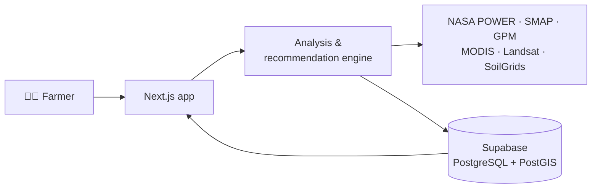
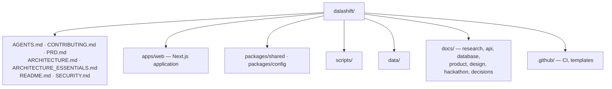

<div align="center">

# DalaShift

**Farm-level agricultural intelligence from NASA Earth observation data.**

</div>

> **Status: Phase 1 — research, product definition, architecture and repository
> foundation.** The product is not yet implemented. This repository contains the
> research, the architecture, the database design and the working agreements
> that the build will follow.
>
> **Working name.** "DalaShift" is provisional. It is not a final brand and
> should not be presented as one.

---

## NASA Space Apps Challenge 2026

**We are building for the "Field Shift: Adapting Farms with NASA Data"
challenge.**

> *"Farmers around the world navigate shifting temperatures, changing rainfall
> patterns, water shortages, extreme weather, and declining soil health.
> These pressures make it difficult to choose crop rotations that protect
> fields, conserve water, and support long‑term resilience. Your challenge is
> to create a decision‑support tool that uses NASA Earth observations along
> with local soil information, crop characteristics, and farmer priorities to
> help farmers explore rotation strategies that could strengthen soil health
> and adapt their farms to changing conditions."*
> — [official 2026 challenge statement](https://www.spaceappschallenge.org/2026/challenges/adapting-farms-with-nasa-data/)

The working name comes from this challenge.

### Key dates

| Date                                    | Event                                            |
| --------------------------------------- | ------------------------------------------------ |
| **Sat 14 Nov 2026, 09:00**              | Kano Local Event starts — EHealth Africa, Badawa, Kano. Project submission opens. |
| **Sun 15 Nov 2026, 23:59 local**        | **Project submission closes.**                    |
| 3 Dec 2026                              | Global Nominees announced                         |
| 17 Dec 2026                             | Global Finalists and Honorable Mentions announced |

Full rules, judging criteria, submission requirements and the verified
dataset research are in **[`docs/hackathon/README.md`](./docs/hackathon/README.md)**.

### What the challenge requires that we must not miss

| Requirement | Status |
| ----------- | ------ |
| Use **at least one NASA data or resource** for Global Award eligibility | Designed in — POWER, IMERG, MODIS, Landsat, SMAP |
| Compare **at least three rotation strategies including the existing one**, each with evidence, benefits, information gaps and local-review risks | Specified as `PRD.md` FR-8 — **not yet built** |
| Use **"farmer priorities"** as an input | Specified as `PRD.md` FR-2.13 — **not yet built** |
| Cite **every** resource, including open-source code | [`THIRD_PARTY_NOTICES.md`](./THIRD_PARTY_NOTICES.md) + the data-source attribution register |
| An **OSI-approved open-source licence** | **OPEN — blocking.** See [`ADR-0001`](./docs/decisions/ADR-0001-open-source-license.md) |
| **Disclose AI/SI tool use** in the submission | Drafted in `THIRD_PARTY_NOTICES.md` § 6 |
| Demo: **≤30 s video or ≤7 slides**, public link, English | Not started |

---

## The problem

Farmers lack **reliable, understandable, farm-specific** information for
decisions that determine their income: soil moisture, rainfall, temperature,
vegetation health, crop suitability, planting timing, and risk.

That information largely exists — in NASA satellite observations, soil maps and
agronomic research. But:

- The datasets are far coarser than a farm. A 9 km soil-moisture pixel covers
  over 80 km², potentially hundreds of separate farms.
- The information is fragmented across services, formats and latencies.
- Raw data is not guidance.
- Location alone cannot tell you what someone is growing.

## The approach

A farmer registers, **draws the boundary of their own land**, says what they
grow or plan to grow, and gets environmental analysis and crop guidance for
*that specific field* — along with an honest statement of how precise each
figure is.

The platform's differentiator is **specificity and honesty**, not imagery. It
is a decision-support tool, not a satellite image viewer.

## How it works



| Stage                       | What happens                                                                    |
| --------------------------- | ------------------------------------------------------------------------------- |
| **Register**                | Farmer account and profile                                                     |
| **Map the farm**            | Search the location, draw the boundary, confirm the computed area               |
| **Declare the crops**       | Current, previous and planned crops; planting dates; plots; intended use        |
| **Analyse**                 | Environmental conditions for that polygon, each with full provenance           |
| **Advise**                  | Deterministic, explainable recommendations with confidence and limitations      |
| **Monitor**                 | How conditions changed, against a climate baseline                              |
| **Report**                  | A printable summary of the farm, its conditions and its recommendations         |

## Field validation

**Tofa Local Government Area, Kano State, Nigeria** is our initial validation
location — the place where the team intends to sit with farmers and learn what
they actually need.

Tofa is the **validation site, not the coverage map**. The architecture is
geographically extensible, and the platform allows searching and selecting
farm locations anywhere in supported coverage. But:

> We have **not** validated this platform across Nigeria, across Africa, or
> globally. Any statement to the contrary is wrong. Field validation is
> scoped to Tofa LGA until it is not.

---

## Tech stack

| Layer       | Choice                                              |
| ----------- | ---------------------------------------------------- |
| Frontend   | Next.js (App Router) · React · TypeScript            |
| UI          | Tailwind CSS · shadcn/ui · Lucide · Recharts         |
| Maps        | MapLibre GL JS                                      |
| Backend     | Next.js server-side (Route Handlers, Server Actions)  |
| Database    | Supabase — PostgreSQL + PostGIS · Auth · Storage · RLS |
| Hosting     | Vercel                                               |
| Tooling     | Node 22 · pnpm workspaces · ESLint · Prettier · Vitest |

---

## Repository layout



---

## Getting started

```bash
corepack enable
pnpm install
cp .env.example apps/web/.env.local   # fill in real values
pnpm dev
```

Full instructions, including Windows setup, branch naming and the commit
convention: **[`CONTRIBUTING.md`](./CONTRIBUTING.md)**.

---

## Documentation

### Start here

| Document                                                     | What it covers                                    |
| ------------------------------------------------------------ | ------------------------------------------------- |
| [`AGENTS.md`](./AGENTS.md)                                   | **Read first.** Rules for AI agents and contributors |
| [`ARCHITECTURE_ESSENTIALS.md`](./ARCHITECTURE_ESSENTIALS.md) | Condensed technical reference — the daily read   |
| [`PRD.md`](./PRD.md)                                         | Product requirements, personas, scope, open questions |
| [`ARCHITECTURE.md`](./ARCHITECTURE.md)                       | Full technical architecture with diagrams        |

### Detailed documentation

| Directory             | Contents                                                                   |
| --------------------- | -------------------------------------------------------------------------- |
| `docs/api/`           | Data source research, verified endpoints, licences, integration strategy  |
| `docs/database/`      | Entity design, PostGIS design, RLS policies, migrations                  |
| `docs/product/`       | User flows, onboarding, recommendation methodology                        |
| `docs/design/`        | Visual direction, design system, accessibility                            |
| `docs/research/`      | NASA datasets, Nigerian agriculture, crop calendars, prior art            |
| `docs/hackathon/`     | NASA Space Apps rules, challenges, submission requirements                |
| `docs/decisions/`     | Architecture decision records (ADRs)                                       |
| `THIRD_PARTY_NOTICES.md` | **Required by the NASA rules.** Every dependency and data source with its licence. |

---

## Data sources and attribution

DalaShift consumes **open, public Earth observation data**. Every source has a
licence and, in most cases, an attribution requirement that the product
renders in-product and this repository records in
[`docs/api/data-sources.md`](./docs/api/data-sources.md).

- NASA data is accessed under the NASA Earth Science Data and Information
  System (ESDIS) open data policies.
- ISRIC SoilGrids is distributed under CC BY 4.0.
- Basemap tiles are served by a third-party provider under its own usage
  policy and attribution requirements.
- Crop requirement data in the catalog cites a source for every value.

**DalaShift is not affiliated with, endorsed by, or partnered with NASA.** It
uses publicly available NASA data. Recommendations are produced by DalaShift's
own agricultural methodology, which requires agricultural knowledge and local
validation — NASA provides Earth observation data, not crop advice.

---

## Team decisions still needed

Several things need the team's decision. They are tracked, not hidden:

| Decision                             | ADR                                                        |
| ------------------------------------ | ---------------------------------------------------------- |
| **Open-source licence (blocking)**   | [`ADR-0001`](./docs/decisions/ADR-0001-open-source-license.md) |
| **Repository visibility (blocking)**  | [`ADR-0009`](./docs/decisions/ADR-0009-repository-visibility.md) |
| Map tile provider                    | [`ADR-0007`](./docs/decisions/ADR-0007-map-tile-provider.md) |
| Google Earth Engine dependency       | [`ADR-0008`](./docs/decisions/ADR-0008-google-earth-engine-dependency.md) |
| Data retention and consent           | [`ADR-0006`](./docs/decisions/ADR-0006-data-retention-and-consent.md) |

See [`docs/decisions/`](./docs/decisions/) for the full index, and
[`PRD.md` § 19](./PRD.md#19-assumptions-and-open-questions) for the open
product questions.

---

## Security

Report vulnerabilities privately per [`SECURITY.md`](./SECURITY.md).
**Do not open a public issue for a security problem.**

---

## License

**Not yet selected — team decision pending.** See
[`LICENSE`](./LICENSE) and
[`ADR-0001`](./docs/decisions/ADR-0001-open-source-license.md). Until a license
is chosen, the repository is unlicensed for redistribution.

---

## Acknowledgements

- **NASA** and the NASA Earth Science Data and Information System (ESDIS) for
  the Earth observation data that makes farm-level environmental analysis
  possible.
- **ISRIC World Soil Information** for SoilGrids.
- The **open-source geospatial community** — MapLibre, Turf, PostGIS, GDAL and
  the many people who maintain them.
- The farmers of Tofa LGA, whose questions this project is built to answer.
