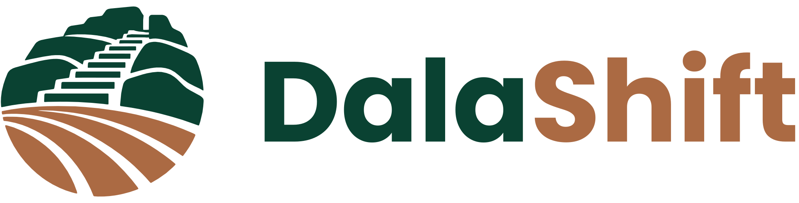
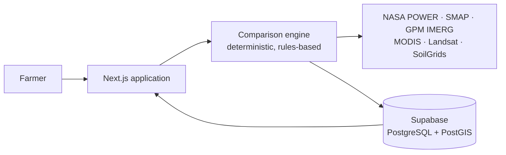
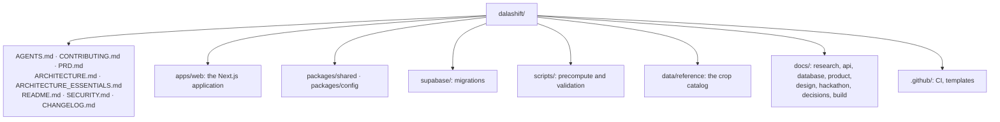

<div align="center">



**Farm-level agricultural intelligence from NASA Earth observation data**

[](https://github.com/vip-ultr/dalashift/actions/workflows/ci.yml)
[](./LICENSE)
[](./CHANGELOG.md)
[](https://nextjs.org/)
[](https://www.typescriptlang.org/)
[](./docs/hackathon/README.md)

</div>

> **Working name.** "DalaShift" is provisional. It is not a final brand and
> must not be presented as one. See
> [`docs/product/brand-and-naming.md`](./docs/product/brand-and-naming.md).
>
> **Independent project.** DalaShift is not affiliated with, endorsed by, or
> partnered with NASA. It uses publicly available NASA Earth observation data.
> Recommendations come from DalaShift's own documented methodology.
>
> **Validation scope.** Field validation covers Tofa Local Government Area,
> Kano State, Nigeria. No wider claim is made.

---

## Contents

- [Why DalaShift](#why-dalashift)
- [Highlights](#highlights)
- [How it works](#how-it-works)
- [What the engine will not do](#what-the-engine-will-not-do)
- [Quick start](#quick-start)
- [Tech stack](#tech-stack)
- [Data sources and attribution](#data-sources-and-attribution)
- [Field validation](#field-validation)
- [NASA Space Apps 2026](#nasa-space-apps-2026)
- [Documentation](#documentation)
- [Project status and layout](#project-status-and-layout)
- [Contributing](#contributing)
- [Security](#security)
- [License](#license)
- [Acknowledgements](#acknowledgements)

---

## Why DalaShift

Farmers lack **reliable, understandable, farm-specific** information for
decisions that determine their income: soil moisture, rainfall, temperature,
vegetation health, crop suitability, planting timing and risk.

That information largely exists, in NASA satellite observations, soil maps and
agronomic research. What is missing is that information turned into an answer
about *their* field, in language they act on.

- The datasets are far coarser than a farm. A 9 km soil-moisture pixel covers
  over 80 km², which can hold hundreds of separate farms.
- The information is fragmented across services, formats and latencies.
- Raw data is not guidance.
- Location alone cannot tell you what someone is growing.

DalaShift's differentiator is **specificity and honesty**, not imagery. It is a
decision-support tool, not a satellite image viewer.

---

## Highlights

| | Capability | What it means |
| :-: | --- | --- |
| 🎯 | **Farm-specific** | Every insight is tied to the farmer's own polygon, not a regional average. |
| 🌱 | **Farmer-supplied truth** | The platform never guesses what a farmer grows. Crop identity comes from the farmer. |
| 🔍 | **Provenance on every value** | Source, real resolution, observation date and measured or modelled status travel with each number. |
| ⚠️ | **Honest uncertainty** | Missing or coarse data lowers confidence and is reported as a limitation. It never becomes a silent default. |
| 🧭 | **Explainable engine** | Deterministic rules, no LLM verdicts. Every recommendation traces to a named input and a versioned ruleset. |
| 🔄 | **Rotation strategies** | The farmer's existing practice compared with alternatives, each with evidence, benefits, gaps and local-review risks. |
| 🔒 | **Privacy by default** | Exact coordinates are stripped from printable and shareable field sheets. Farmers read only their own data under RLS. |

---

## How it works



| Stage | What happens |
| ----- | ------------ |
| **Register** | A first-party account, with a profile. |
| **Map the farm** | A holding of one or more parcels. Each parcel is captured by GPS with an accuracy radius, or drawn on the map. The area is computed by PostGIS and confirmed back to the farmer. |
| **Declare the crops** | Current, previous and planned crops, with the planting period, the season and the intended use. |
| **Analyse** | Environmental conditions for that parcel, each carrying its source, its real resolution, its observation date and whether it is modelled. |
| **Advise** | The farmer's existing practice compared against alternatives. Measured values against cited thresholds, with the evidence and its limits stated. |
| **Plant** | A trigger condition rather than a calendar date, with the farmer's own rule as an input and the trade-off explained. |
| **Report** | A printable summary of the holding, its conditions and its comparisons, with source attribution and coordinates redacted. |

---

## What the engine will not do

It does not predict yield. It does not recommend a specific variety. It does
not diagnose a disease from imagery. It does not give a spray or input
schedule. It does not forecast the weather. It produces **no composite
suitability score, no weighting system, no confidence percentage and no verdict
threshold**, because an arbitrary number presented with false precision is not
information.

Every rotation strategy instead carries a rationale, the evidence behind it,
the benefits it may offer, the information gaps that remain, and the risks
that need local review by a farmer or an agricultural expert.

---

## Quick start

```bash
corepack enable
pnpm install
cp .env.example .env.local   # fill in web runtime values only
pnpm dev
```

The web commands load the repository-root `.env.local`, deployment-provided
values take precedence, and the file is optional on Vercel. If your local
settings are still in `apps/web/.env.local`, migrate only the web runtime
values to the root file. Keep Supabase CLI credentials in the CLI's user-level
login or its password prompts, never in the web environment.

Full instructions, including Windows setup, branch naming and the commit
convention, are in [`CONTRIBUTING.md`](./CONTRIBUTING.md).

### Checks

```bash
pnpm check            # format:check, lint, typecheck
pnpm test             # Vitest
pnpm validate:links   # relative Markdown link check
pnpm validate:style   # writing convention check: no em dashes
```

The last two run in CI and fail the build. Fix the file rather than skipping
the check.

---

## Tech stack

| Layer | Choice |
| ----- | ------ |
| Frontend | Next.js 16 (App Router) · React 19 · TypeScript (strict) |
| UI | Tailwind CSS v4 · shadcn/ui · Lucide · Recharts |
| Maps | MapLibre GL JS with a satellite basemap and Terra Draw |
| Backend | Next.js server-side (Route Handlers and Server Actions) |
| Database | Supabase: PostgreSQL + PostGIS · Storage · Row Level Security |
| Authentication | First-party accounts with server-managed sessions. See [`ADR-0012`](./docs/decisions/ADR-0012-first-party-authentication.md) |
| Hosting | Vercel |
| Tooling | Node 22 · pnpm workspaces · ESLint · Prettier · Vitest · Playwright |

The Next.js application is the single deployable. There is no separate API
service. External API calls happen only in the server-only integration layer,
and every external payload is validated with Zod before it enters the system.

---

## Data sources and attribution

DalaShift consumes **open, public Earth observation data**. Every source has a
licence and, in most cases, an attribution requirement that the product renders
in-product and this repository records in
[`docs/api/data-sources.md`](./docs/api/data-sources.md).

- NASA data is accessed under the NASA Earth Science Data and Information
  System (ESDIS) open data policies.
- ISRIC SoilGrids is distributed under CC BY 4.0.
- Basemap tiles are served by a third-party provider under its own usage
  policy and attribution requirements.
- Every crop requirement in the catalog cites a source. The register is
  [`docs/research/evidence-register.csv`](./docs/research/evidence-register.csv),
  and it records where each study was done, what it does not show, and how
  far it can be trusted for Tofa.

NASA provides Earth observation data, not crop advice. DalaShift's
recommendations require agricultural knowledge, a methodology and local
validation. Every dependency and data source with its licence is recorded in
[`THIRD_PARTY_NOTICES.md`](./THIRD_PARTY_NOTICES.md).

---

## Field validation

**Tofa Local Government Area, Kano State, Nigeria** is the validation location.
Three farmers in **Doka village** were interviewed as semi-structured research
participants, and their records are the ground truth the product is built to
serve:

| Farmer | Holding | Practice |
| ------ | ------- | -------- |
| Bello Yusuf Maitama | 2 to 4 ha, not contiguous | Strip cropping. Waits for the soil to hold moisture before planting. |
| Amina Habibu | About 4 ha across three "hectares" and two smaller plots | Ridge-based strip plans, rotation learned through Bayero University extension training. |
| Abubakar (Dan Hajiya) | About 30 ha owned, in 3 ha parcels | A two-to-three-year plot-level rotation cycle, modern short-duration varieties. |

The case studies, with their consent records, are in
[`docs/research/field-interviews/`](./docs/research/field-interviews/).

Tofa is the **validation site, not the coverage map**. The architecture is
geographically extensible and the platform can search and select farm
locations anywhere in supported coverage. But:

> We have **not** validated this platform across Nigeria, across Africa, or
> globally. Any statement to the contrary is wrong. Field validation is
> scoped to Tofa LGA until it is not.

---

## NASA Space Apps 2026

We are building for the **"Field Shift: Adapting Farms with NASA Data"**
challenge.

> *"Farmers around the world navigate shifting temperatures, changing rainfall
> patterns, water shortages, extreme weather, and declining soil health.
> These pressures make it difficult to choose crop rotations that protect
> fields, conserve water, and support long-term resilience. Your challenge is
> to create a decision-support tool that uses NASA Earth observations along
> with local soil information, crop characteristics, and farmer priorities to
> help farmers explore rotation strategies that could strengthen soil health
> and adapt their farms to changing conditions."*
> Source: [official 2026 challenge statement](https://www.spaceappschallenge.org/2026/challenges/adapting-farms-with-nasa-data/)

The working name comes from this challenge.

### Key dates

| Date | Event |
| ---- | ----- |
| **Sat 14 Nov 2026, 09:00** | Kano Local Event starts at EHealth Africa, Badawa, Kano. Project submission opens. |
| **Sun 15 Nov 2026, 23:59 local** | **Project submission closes.** |
| 3 Dec 2026 | Global Nominees announced |
| 17 Dec 2026 | Global Finalists and Honorable Mentions announced |

The rules, judging criteria, submission requirements and the verified dataset
research are in **[`docs/hackathon/README.md`](./docs/hackathon/README.md)**.

### What the challenge requires

| Requirement | How DalaShift meets it |
| ----------- | ---------------------- |
| Use **at least one NASA data or resource** for Global Award eligibility | NASA POWER, SMAP, GPM IMERG, MODIS and Landsat are the backbone of the environmental layer, not decoration |
| Compare **at least three rotation strategies including the existing one**, each with evidence, benefits, information gaps and local-review risks | The comparison engine produces the farmer's existing practice plus alternatives, and every strategy carries the four fields the brief asks for |
| Use **"farmer priorities"** as an input | Priorities and risk tolerance are captured per farm and change the ordering, and the output says why |
| Cite **every** resource, including open-source code | [`THIRD_PARTY_NOTICES.md`](./THIRD_PARTY_NOTICES.md), the attribution register in [`docs/api/data-sources.md`](./docs/api/data-sources.md), and the agronomic citation register in [`docs/research/evidence-register.csv`](./docs/research/evidence-register.csv) |
| An **OSI-approved open-source licence** | Apache License 2.0. See [`LICENSE`](./LICENSE) and [`ADR-0001`](./docs/decisions/ADR-0001-open-source-license.md) |
| **Disclose AI/SI tool use** in the submission | [`THIRD_PARTY_NOTICES.md`](./THIRD_PARTY_NOTICES.md) section 6 |
| Demo: **30 s video or 7 slides**, public link, English | [`docs/hackathon/DalaShift_NASA_Space_Apps_2026.pptx`](./docs/hackathon/) and the matching PDF |

---

## Documentation

### Start here

| Document | What it covers |
| -------- | -------------- |
| [`AGENTS.md`](./AGENTS.md) | **Read first.** The rules for AI agents and contributors |
| [`CHANGELOG.md`](./CHANGELOG.md) | What was built, in order |
| [`ARCHITECTURE_ESSENTIALS.md`](./ARCHITECTURE_ESSENTIALS.md) | The condensed technical reference, the daily read |
| [`PRD.md`](./PRD.md) | Product requirements, personas, scope, open questions |
| [`ARCHITECTURE.md`](./ARCHITECTURE.md) | The full technical architecture with diagrams |

### Build plan

| Document | Purpose |
| -------- | ------- |
| [`docs/build/TEAM-PLAN.md`](./docs/build/TEAM-PLAN.md) | Who owns what, the branch and push workflow, the definition of done |
| [`docs/build/PAGES.md`](./docs/build/PAGES.md) | **Every page and every API route, what is on it, and who owns it** |
| [`docs/build/BACKEND.md`](./docs/build/BACKEND.md) | Schema, integrations, the engine contract, the keys the build needs |
| [`docs/build/BRAND.md`](./docs/build/BRAND.md) | Palette, typography, component rules, the logo and favicon specification |
| [`docs/build/AGENT-PROMPTS.md`](./docs/build/AGENT-PROMPTS.md) | A ready-to-paste prompt for each person's agent |

### Detailed documentation

| Directory | Contents |
| --------- | -------- |
| `docs/api/` | Data source research, verified endpoints, licences, integration strategy |
| `docs/database/` | Entity design, PostGIS design, RLS policies, migrations |
| `docs/product/` | User flows, recommendation methodology |
| `docs/design/` | Visual direction, design system, accessibility |
| `docs/research/` | NASA datasets, Nigerian agriculture, crop calendars, prior art, the field interviews, the agronomic evidence register |
| `docs/hackathon/` | NASA Space Apps rules, challenges, submission requirements, the presentation deck |
| `docs/decisions/` | Architecture decision records and the open decisions register |
| [`THIRD_PARTY_NOTICES.md`](./THIRD_PARTY_NOTICES.md) | **Required by the NASA rules.** Every dependency and data source with its licence |

### Team decisions still open

| Decision | ADR |
| -------- | --- |
| Map tile provider | [`ADR-0007`](./docs/decisions/ADR-0007-map-tile-provider.md) |
| Google Earth Engine dependency | [`ADR-0008`](./docs/decisions/ADR-0008-google-earth-engine-dependency.md) |
| Data retention and consent | [`ADR-0006`](./docs/decisions/ADR-0006-data-retention-and-consent.md) |
| Field verification actions V-01 to V-08 | [`OPEN-DECISIONS.md`](./docs/decisions/OPEN-DECISIONS.md) Part E |

---

## Project status and layout

> **Status: the build is live.** DalaShift is a working web application with
> versioned database migrations, a deterministic comparison engine, live NASA
> data integration and first-party accounts. See
> [`CHANGELOG.md`](./CHANGELOG.md) for the implementation record.

This repository was created on **13 November 2026**, the day before the 2026
NASA Space Apps Challenge began, and was committed before the event started.
Before the event it held the preparation foundation:

| In this repository before the event | Not in this repository before the event |
| ---------------------------------- | -------------------------------------- |
| Research into NASA and other open data sources, with citations and verification dates | Authentication, the farmer dashboard, functional maps |
| Product definition: requirements, personas, user flows | Live NASA API integration |
| Technical architecture, database design, RLS design | The crop recommendation engine |
| A working repository skeleton, tooling and CI | Database migrations, reports, product pages |

The working application and the versioned schema are now in `apps/web/` and
`supabase/migrations/`. This history is retained so that what was prepared
before the event and what was built during it stays clear.

Wherever an agronomic value or a recommendation appears in this repository, it
comes from a cited source or from the documented rules engine, never from an AI
model generating agronomic facts.



**Repository:** <https://github.com/vip-ultr/dalashift>, **public**. See
[`ADR-0009`](./docs/decisions/ADR-0009-repository-visibility.md).

---

## Contributing

Contributions are welcome. Read [`AGENTS.md`](./AGENTS.md) first, then
[`CONTRIBUTING.md`](./CONTRIBUTING.md) for setup, branch naming, the commit
convention and the definition of done. Run `pnpm check` before pushing.

---

## Security

Report vulnerabilities privately per [`SECURITY.md`](./SECURITY.md).
**Do not open a public issue for a security problem.**

---

## License

**Apache License 2.0.** See [`LICENSE`](./LICENSE) for the full text and
[`ADR-0001`](./docs/decisions/ADR-0001-open-source-license.md) for the
decision.

The licence covers the code only. Each data source keeps its own terms, and
the attribution obligations are discharged in-product and in every generated
report.

---

## Acknowledgements

- **NASA** and the NASA Earth Science Data and Information System (ESDIS) for
  the Earth observation data that makes farm-level environmental analysis
  possible.
- **ISRIC World Soil Information** for SoilGrids.
- **Bayero University** and the agricultural extension officers of Kano State
  for the research partnership and the field interviews.
- The **open-source geospatial community**: MapLibre, Turf, PostGIS, GDAL and
  the many people who maintain them.
- The farmers of Doka village, Tofa LGA, whose questions this project is
  built to answer.
