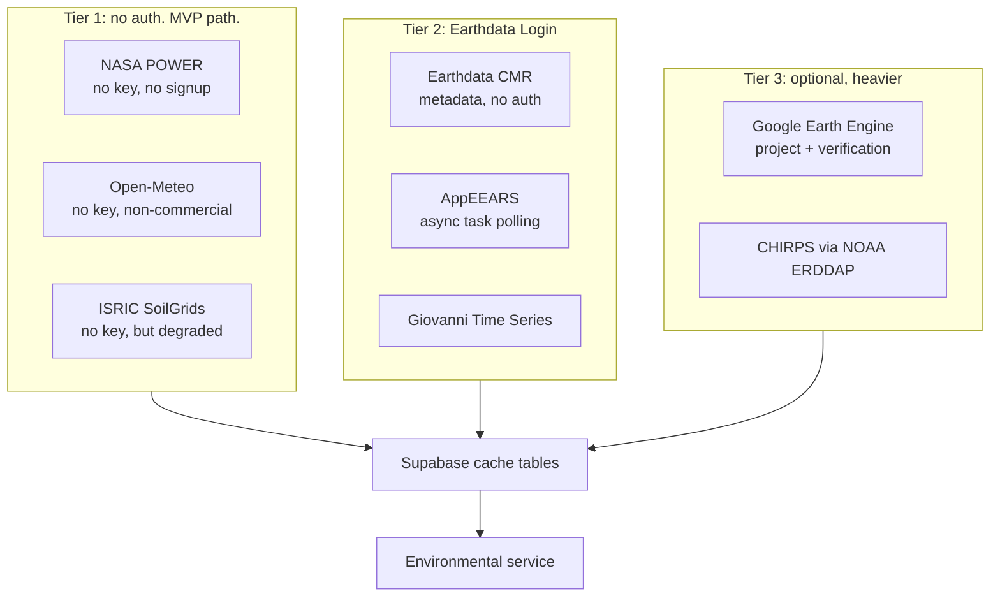
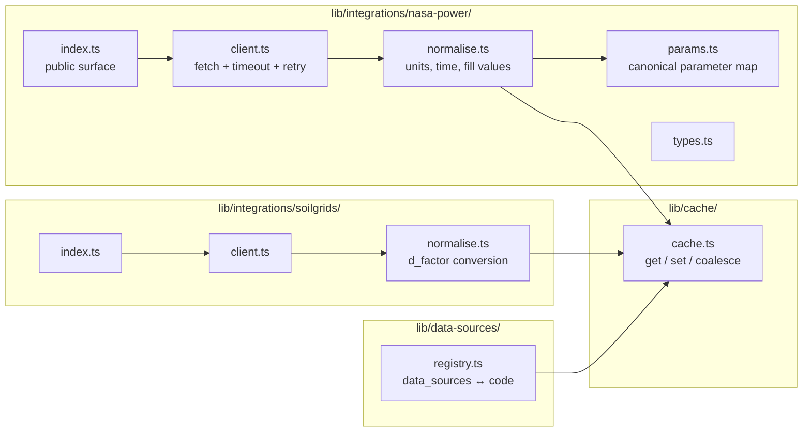

# Data Retrieval Strategy

**Verification date: 2026-11-13.** Companion to
[`data-sources.md`](./data-sources.md), which holds the per-source facts.

---

## 1. The governing constraint

Three facts from the research drive every decision here:

1. **The resolution gap is real and unavoidable.** POWER is ~55 km, SMAP 9 km,
   IMERG 11 km, CHIRPS 5.5 km. A farm is smaller than a pixel in all of them.
2. **The MVP path must not depend on an account approval.** USGS M2M takes
   *"a couple of days"*; GEE needs a verification questionnaire; LAADS was
   refusing to issue tokens. A demo that depends on any of these can fail on
   a technicality.
3. **Upstreams are slow, flaky and rate-limited.** SoilGrids is degraded with
   a confirmed data void at (8.5, 12.0). POWER blocks repeated requests.
   Open-Meteo explicitly warns that Vercel-hosted apps may be rate-limited
   earlier than expected.

**Therefore: cache everything, pre-compute what is static, and prefer no-auth
sources for the demo path.**

---

## 2. Integration tiers



| Tier | Sources | Why this tier |
| ---- | ------- | ------------- |
| **1** | POWER, Open-Meteo, SoilGrids | Zero account setup. Works the moment credentials are set. Covers rainfall, temperature, radiation, evapotranspiration, soil wetness, soil properties and forecast. |
| **2** | CMR, AppEEARS, Giovanni | One free Earthdata account covers all of them. Needed for SMAP granules and MODIS/Landsat without GEE. |
| **3** | GEE, CHIRPS | Highest value (farm-scale pixels) or highest setup cost. Strictly optional. |

**Build order: Tier 1 → demo works. Tier 2 → add soil moisture and raster
context. Tier 3 → only if there is time.**

---

## 3. The per-source call strategy

| Source | Call pattern | Where it runs | Cache key |
| ------ | ------------ | ------------- | --------- |
| **POWER: climatology** | Once per farm, per parameter set | Server, on farm save | `(farm_id, parameter_set)`: **never expires** |
| **POWER: daily/monthly** | Once per farm per period | Server | `(farm_id, parameter, period)`: rolling 90-day refresh, older rows frozen |
| **POWER: regional** | **Never for Kano**: bbox < 2° × 2° is rejected (HTTP 422) | n/a | n/a |
| **Open-Meteo forecast** | On demand, hourly | Server | `(farm_id, run_date)`: TTL 1 hour |
| **Open-Meteo historical** | On demand | Server | `(farm_id, date)`: permanent |
| **SoilGrids** | **Pre-baked**, not live | `scripts/geospatial/` | `(grid_cell_250m, property, depth)`: never expires |
| **SMAP (CMR/AppEEARS)** | On demand | Server | `(farm_id, date, am_pm)`: TTL 7 days |
| **MODIS NDVI (GEE/CMR)** | On demand | Server | `(farm_id, composite_date)`: TTL 20 days |
| **Landsat (GEE)** | On demand | Server | `(farm_id, scene_date)`: permanent (scenes are immutable) |
| **Sentinel-2 (GEE)** | On demand | Server | `(farm_id, composite_date)`: TTL 7 days |
| **IMERG (POWER `IMERG_PRECTOT`)** | On demand | Server | `(farm_id, date)`: TTL 7 days for Early/Late, permanent for Final |
| **CHIRPS (ERDDAP)** | On demand | Server | `(grid_cell, date)`: TTL 7 days (Preliminary) |

### Cache-key design rule

**For gridded products, key on the rounded grid cell, not the exact
coordinate.** 200 farms in the same 250 m SoilGrids cell, or the same 9 km SMAP
cell, should share one cached row. This turns an N-farm problem into an
N-distinct-cells problem.

```
SoilGrids:  key = (round(lat, 2.5), round(lon, 2.5), property, depth)
SMAP:       key = (round(lat, 3), round(lon, 3), date, am_pm)
POWER:      key = (round(lat, 2), round(lon, 2), parameter, date)   // ~55 km cell
IMERG:      key = (round(lat, 2), round(lon, 2), date)
```

### Request coalescing

Two farmers opening the same farm at the same moment must not cause two
upstream calls. An in-process `Map` keyed by cache key, holding the in-flight
promise, deduplicates concurrent requests. The durable cache handles the
cross-cold-start case.

---

## 4. Pre-computation: what to bake before the hackathon

These artifacts should exist **before** the demo, so the demo never depends on
a live upstream.

| Artifact                                          | How                                                      | Coverage                                              |
| ------------------------------------------------- | -------------------------------------------------------- | ----------------------------------------------------- |
| **POWER climatology** for the validation region    | One `climatology/point` call per grid cell, batched      | ~20 km around Tofa LGA, every 0.5° cell               |
| **SoilGrids** for the validation region            | `files.isric.org` WebDAV tiles → clip → tile → store      | Same region, 250 m tiles, all properties × 6 depths    |
| **Rainfall normals** (CHIRPS or POWER)             | From the climatology + CHIRPS daily series                | Same region                                             |
| **Demo farm fixtures**                             | Scripted farms with realistic polygons, crops and soil   | 3 to 5 farms, synthetic but plausible                   |
| **Crop catalog**                                   | Versioned JSON in the repo, seeded into `crops`          | The crops actually grown in the validation area         |
| **Crop calendar** (Sacks)                           | Download the netCDF once, extract the Nigeria cells      | Crops and cells we care about                          |

**[Proposed]** The pre-computation script lives in
`scripts/geospatial/` and is idempotent. It writes to `data/processed/`
(gitignored) and to the `grid_cells` / `soil_properties` tables.

---

## 5. The observation contract

Every integration returns this shape. Nothing else crosses the boundary.

```ts
interface ProvenancedValue {
  /** Canonical variable id, e.g. "precipitation_mm" */
  variable: string;
  /** The value in the canonical unit */
  value: number;
  /** Canonical unit: "mm", "degC", "m3_m3", "1" (dimensionless), "MJ_m2_day" */
  unit: string;
  /** FK → data_sources */
  sourceId: string;
  /** Spatial resolution of the underlying observation, in metres */
  spatialResolutionM: number;
  /** "daily" | "hourly" | "16-day" | "monthly" | "climatology" */
  temporalResolution: string;
  /** ISO 8601 UTC: when the observation was made */
  observedAt: string;
  /** ISO 8601 UTC: when we fetched it */
  retrievedAt: string;
  /** True when the source modelled or interpolated the value */
  isModelled: boolean;
  /** "good" | "suspect" | "missing" | "partial" */
  qualityFlag?: "good" | "suspect" | "missing" | "partial";
  /** Fraction of the target geometry with valid data, 0 to 1 */
  coverageFraction?: number;
  /** Source-specific identifiers kept for the audit trail */
  rawMetadata?: Record<string, unknown>;
}
```

**Rules the integration layer must enforce:**

1. **Strip fill values.** POWER uses `-999.0` and declares it in
   `header.fill_value`. Never average it in.
2. **Normalise units.** `degC` for temperature, `mm` for precipitation,
   `m3_m3` for volumetric soil moisture, `1` for dimensionless soil wetness.
3. **Normalise time to UTC.** POWER's LST standard must be recorded as
   metadata, not silently converted: the local solar time offset is
   meaningful for daily aggregation.
4. **Convert SoilGrids mapped units using `d_factor`.** `phh2o` 67 → 6.7 pH.
   `clay` 137 → 13.7 %. This is a 10× error if missed.
5. **Preserve the run identifier** for IMERG (Early / Late / Final) so runs are
   never mixed in one series.
6. **Never fabricate.** A missing period is a `missing` observation with a
   `coverageFraction` of 0, not a zero, not an interpolation.

---

## 6. Failure handling

| Failure                        | Detection                              | Response                                                     |
| ------------------------------ | -------------------------------------- | ------------------------------------------------------------ |
| HTTP 5xx                       | Status code                            | Retry ≤ 2 with exponential backoff, then `UpstreamError`      |
| Timeout                        | Abort after the module's timeout       | `UpstreamTimeout`; surface as "temporarily unavailable"       |
| HTTP 429                       | Status code                            | Honour `Retry-After`; cache the error briefly; do not hammer  |
| HTTP 404 from an upstream      | Status code                            | `NoDataError`, **not an error**; record a data gap           |
| HTTP 200 with `null` values    | Schema validation                     | Treat as **no data**, not as zero                            |
| `-999` fill values             | `header.fill_value`                    | Drop and recompute coverage fraction                          |
| Partial coverage               | `coverageFraction < 1`                 | Store the value with the fraction; confidence drops           |
| 401 / 403                      | Status code                            | `AuthError` → operator alert, generic user message             |
| SoilGrids HTTP 200 with nulls  | Live-verified failure mode             | Treat as no data; fall back to the pre-baked tile table        |

**The demo path must never fail.** If the demo relies on a live upstream call
and that upstream is down, the demo is over. **Seed the cache before the
pitch.**

---

## 7. Rate-limit compliance

| Source                | Documented limit                                | Our strategy                                       |
| --------------------- | ----------------------------------------------- | -------------------------------------------------- |
| NASA POWER            | No published number; **blocks repeated calls**  | Cache per grid cell. One call per cell, ever.       |
| NASA POWER regional   | 1 parameter per request; bbox ≥ 2° × 2°          | **Not used**: use the point endpoint.              |
| SoilGrids            | **5 calls / minute** (Fair Use Policy)          | **Pre-baked.** Zero live calls.                     |
| Open-Meteo            | 600/min, 5,000/hr, 10,000/day, 300,000/mo; **per IP + per app**; Vercel may be limited earlier | Cache 1 hour. Optionally route through a Cloudflare Worker. |
| Earthdata CMR        | UNVERIFIED                                      | Metadata-only, cached.                              |
| GEE                   | 40 concurrent; 100 req/s; 2 avg batch tasks; 150 EECU-hr/mo (Community) | Batch per farm, not per pixel. Cache results. |
| CHIRPS / ERDDAP       | UNVERIFIED (server is slow)                      | Cache aggressively.                                 |

**The Vercel warning deserves attention.** Open-Meteo applies limits per IP
*and* per application, and warns that serverless platforms may exhaust them
faster. If the demo is under pressure, a Cloudflare Worker in front of
Open-Meteo is the documented escape hatch, a small, cheap mitigation worth
keeping in reserve.

---

## 8. Staleness policy

| Data class                | Refresh                          | Reason                                              |
| ------------------------- | -------------------------------- | ---------------------------------------------------- |
| POWER climatology         | Never (annual refresh)           | Multi-year baseline is stable                        |
| POWER daily (last 90 d)   | **Rolling refresh**              | The archive is superseded for ~2 to 3 months          |
| POWER daily (> 90 d old)  | **Frozen**                       | Final and immutable                                  |
| SoilGrids                 | Never                           | Static predictions                                   |
| SMAP                      | 7 days                          | Near-real-time; a later run may improve a flagged value |
| MODIS NDVI                | 20 days                         | Matches the 16-day composite period                  |
| Landsat                   | Never for closed scenes          | Scenes are immutable                                 |
| Sentinel-2                | 7 days                          | A new clear scene may change the composite           |
| IMERG Early/Late          | 7 days                          | Provisional runs are updated                          |
| IMERG Final               | Never                           | Gauge-calibrated and final                           |
| Open-Meteo forecast       | **1 hour**                      | Forecasts go stale in hours                          |

**Staleness is shown, not hidden.** A cached value keeps its `observedAt`, and
the interface distinguishes *"as of 3 days ago"* from *"current"*.

---

## 9. Integration module structure



**Every module exposes the same surface:**

```ts
export interface DataSourceModule {
  id: string;                       // matches data_sources.source_key
  fetch<Variable>(input): Promise<ProvenancedValue[]>;
  fetchSeries(input): Promise<ProvenancedValue[]>;
  capabilities: { variables: string[]; maxPointParameters: number };
}
```

`lib/data-sources/registry.ts` maps the code-level `sourceId` to the
`data_sources` row, so the registry in the database and the code stay in sync
and the UI can render attribution generically.

---

## 10. What is stored, and what is not

| Stored in Supabase                                      | Not stored                                    |
| -------------------------------------------------------- | --------------------------------------------- |
| Normalised observation values with full provenance        | Raw upstream payloads (except a trimmed `raw_metadata`) |
| The **grid cell** a coarse value belongs to              | Rasters, tiles, NetCDF, GeoTIFF                |
| Coverage fraction and quality flags                       | Anything larger than a few hundred bytes of raw payload |
| Cache entries with an explicit expiry                     | Anything with no TTL in a cache table         |

---

## 11. Implementation sequence for Phase 2

**Progress note (2026-11-14):** the server-only NASA POWER daily point adapter
is implemented for precipitation, mean/max/min air temperature and
root-zone wetness. It validates the provider response, removes declared fill
values, records the returned time standard and source metadata, and bounds
request retries. Durable caching and persistence are not implemented yet, so
this adapter must not be wired to an unthrottled user-facing request path.

| Step | Work                                                              | Risk |
| ---- | ----------------------------------------------------------------- | ---- |
| 1    | `lib/integrations/nasa-power`: daily, monthly, climatology, point only | Low |
| 2    | `lib/cache` + `environmental_observations` + `grid_cells` tables   | Low |
| 3    | `lib/integrations/soilgrids`: **pre-baked tile lookup**, not live   | Medium (service degraded) |
| 4    | `lib/integrations/open-meteo`: forecast + historical              | Low |
| 5    | `scripts/geospatial/precompute-region.ts`: bake the demo region   | Medium |
| 6    | `lib/integrations/nasa-cmr` + AppEEARS (SMAP, MODIS)               | Medium (auth) |
| 7    | `lib/integrations/gee`: Sentinel-2, Landsat, MODIS                | High (setup) |
| 8    | CHIRPS via ERDDAP                                                  | Medium |

**Steps 1 to 5 are the MVP path** and need no account beyond Supabase.
Steps 6 to 8 are enhancements.
