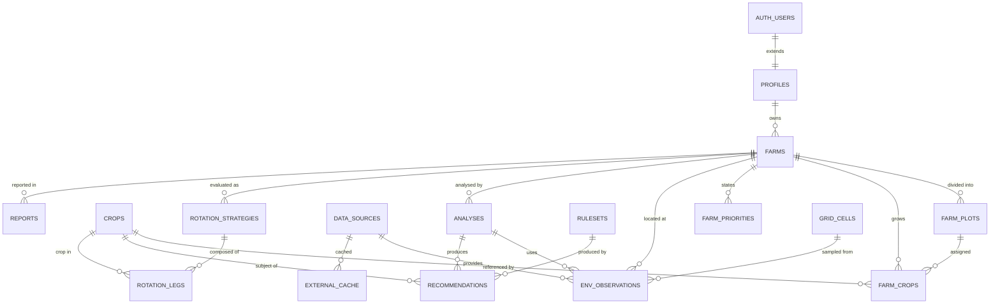

# Database Design

**Status: Phase 1 — specification only. No migrations exist yet.**
The schema is implemented in Phase 2 under `supabase/migrations/`.

Related: [`postgis-design.md`](./postgis-design.md) ·
[`rls-policies.md`](./rls-policies.md) · [`../api/data-sources.md`](../api/data-sources.md)

---

## 1. Platform

Supabase = managed PostgreSQL with **PostGIS**, plus Auth, Storage and Row
Level Security. The team owns the schema through versioned migrations; the
Supabase dashboard is not used to create tables.

**Design rules:**

1. **RLS on every table that holds farmer data.** A table shipped without
   policies is a security defect.
2. **Provenance is part of the data**, not metadata bolted on afterwards.
3. **PostGIS computes the geometry.** No area or containment is computed in
   JavaScript for storage.
4. **Store the resolution, not just the value.**
5. **Never store a raster.**

---

## 2. Entity model

---

## 3. Table specifications

### 3.1 `profiles`

Extends `auth.users`. Created by a trigger on user insert.

| Column            | Type        | Notes                                                        |
| ----------------- | ----------- | ------------------------------------------------------------ |
| `id`              | `uuid` PK   | `= auth.users.id`. **The RLS identity anchor.**            |
| `full_name`       | `text`      | Required.                                                    |
| `phone`           | `text`      | Contact for reports and field follow-up.                     |
| `preferred_language` | `text`   | `default 'en'`. **[Proposed]** collected only if an interface language ships. |
| `farming_experience` | `text`    | Free text or a controlled enum. Optional.                     |
| `role`            | `text`      | `farmer` \| `extension_worker` \| `researcher` \| `admin`. Default `farmer`. |
| `created_at`      | `timestamptz` | `default now()`                                            |
| `updated_at`      | `timestamptz` | `default now()`, maintained by trigger                      |

**Indexes:** PK on `id`. Optional b-tree on `role` if the admin view grows.

---

### 3.2 `farms`

| Column              | Type          | Notes                                                                  |
| ------------------- | ------------- | ---------------------------------------------------------------------- |
| `id`                | `uuid` PK     | `default gen_random_uuid()`                                           |
| `farmer_id`         | `uuid` FK     | → `profiles(id)` `on delete cascade`. **The RLS anchor.**             |
| `name`              | `text`        | Required.                                                             |
| `centroid`          | `geometry`    | `Point`, SRID 4326. `generated always as (st_centroid(boundary)) stored`. |
| `boundary`          | `geometry`    | `Polygon`/`MultiPolygon`, SRID 4326. Not null.                        |
| `area_ha`           | `numeric(10,3)` | `generated always as (st_area(boundary::geography)/10000) stored`. **Computed by the database.** |
| `elevation_m`       | `numeric(7,2)` | Optional; from SRTM or the POWER grid cell.                            |
| `farming_method`    | `text`        | `rainfed` \| `irrigated` \| `mixed` \| `unknown`. Default `unknown`.   |
| `irrigation_method` | `text`        | See `packages/shared/constants`. Default `unknown`.                    |
| `soil_notes`        | `text`        | Free text from the farmer. Optional.                                   |
| `soil_info`         | `jsonb`       | Optional structured soil observations from the farmer.                  |
| `created_at`        | `timestamptz` |                                                                 |
| `updated_at`        | `timestamptz` |                                                                 |

**Constraints:**
- `CHECK (NOT ST_IsEmpty(boundary))`
- `CHECK (ST_IsValid(boundary))` — or normalise with `ST_MakeValid` on write
- `CHECK (area_ha > 0 AND area_ha < 100000)`

**Indexes:**
- `GIST (boundary)`, `GIST (centroid)`
- `btree (farmer_id)`

**Note on the generated columns.** `area_ha` and `centroid` are
`generated always as ... stored`, so they **cannot** be written by the client.
A malicious or buggy client cannot set an arbitrary farm size. The Turf area
computed in the browser is a preview only; this column is the truth.

---

### 3.3 `farm_plots`

A sub-division of a farm with its own crop assignment.

| Column       | Type            | Notes                                              |
| ------------ | --------------- | -------------------------------------------------- |
| `id`         | `uuid` PK       |                                                     |
| `farm_id`    | `uuid` FK       | → `farms(id)` `on delete cascade`                    |
| `name`       | `text`          | e.g. "Plot 1"                                       |
| `boundary`   | `geometry`      | Polygon, SRID 4326. Null if the plot is not mapped.  |
| `area_ha`    | `numeric(10,3)` | Generated from the boundary when present.            |
| `notes`      | `text`          |                                                     |
| `created_at` | `timestamptz`   |                                                     |

**Why it exists now, not later:** adding plots after launch requires backfilling
crop records and recomputing every historical analysis. Carrying a nullable
`plot_id` from day one costs one column. See `PRD.md` § 9.3.

---

### 3.4 `crops` — the reference catalog

Seeded from the versioned catalog in the repository. **Every agronomic value
must cite a source.**

| Column                   | Type        | Notes                                                      |
| ------------------------ | ----------- | ---------------------------------------------------------- |
| `id`                     | `uuid` PK   |                                                             |
| `code`                   | `text` UNIQUE| e.g. `millet`, `maize`, `rice`, `cowpea`, `groundnut`     |
| `name`                   | `text`      | Display name                                                |
| `category`               | `text`      | `cereal` \| `legume` \| `vegetable` \| `root` \| `tuber` \| `cash_crop` |
| `growing_period_days`    | `integer`   | Typical days from sowing to harvest                        |
| `agronomic_requirements` | `jsonb`     | Temperature range, rainfall range, soil pH/texture/drainage, water demand, planting window, GDD requirement |
| `rotation_traits`        | `jsonb`     | Nitrogen contribution, residue load, disease break effects, pollinators |
| `source_citations`       | `jsonb`     | **Array of { claim, value, source_url, accessed_on }. Mandatory.** |
| `ruleset_version`        | `text`      | Catalog version this row belongs to                         |
| `created_at`             | `timestamptz` |                                                           |

**Constraint:** `CHECK (jsonb_array_length(source_citations) > 0)` — a crop
without a citation cannot be inserted.

---

### 3.5 `farm_crops`

| Column                   | Type        | Notes                                                       |
| ------------------------ | ----------- | ----------------------------------------------------------- |
| `id`                     | `uuid` PK   |                                                              |
| `farm_id`                | `uuid` FK   | → `farms(id)` `on delete cascade`                            |
| `plot_id`                | `uuid` FK   | → `farm_plots(id)` `on delete set null`. Nullable.           |
| `crop_id`                | `uuid` FK   | → `crops(id)`                                                |
| `status`                 | `text`      | `current` \| `previous` \| `planned`. **Check constraint.**   |
| `planting_date`          | `date`      | Nullable — often unknown                                     |
| `expected_harvest_date`  | `date`      | Nullable                                                     |
| `harvest_date`           | `date`      | Nullable — actual                                            |
| `season`                 | `text`      | `rainy` \| `dry` \| `harmattan` \| `year_round` \| `unknown`  |
| `intended_use`           | `text`      | `commercial` \| `household` \| `both` \| `unknown`            |
| `area_ha`                 | `numeric(10,3)` | Nullable — may differ from the plot area                |
| `notes`                  | `text`      |                                                              |
| `created_at`             | `timestamptz` |                                                            |

**Indexes:** `btree (farm_id, status)`, `btree (crop_id)`.

**Why `status` and not three tables:** a crop record moves `planned` →
`current` → `previous` over time. One table with a status keeps the history
queryable without a join, and the transition is a single `UPDATE`.

---

### 3.6 `farm_priorities`

The farmer's stated objectives for a farm. **Required by the NASA Space Apps
"Field Shift" challenge brief** (which names "farmer priorities").

| Column            | Type        | Notes                                                              |
| ----------------- | ----------- | ------------------------------------------------------------------ |
| `id`              | `uuid` PK   |                                                                     |
| `farm_id`         | `uuid` FK   | → `farms(id)` `on delete cascade`. Unique.                         |
| `goals`           | `text[]`    | e.g. `['improve_soil_fertility','conserve_water','increase_income','food_security']` |
| `risk_tolerance`  | `numeric(3,2)` | 0 (risk-averse) to 1 (risk-seeking). Nullable.                   |
| `open_to_change`  | `boolean`   | Nullable — whether the farmer will accept a different crop.         |
| `notes`           | `text`      | Free-text priorities the farmer types.                              |
| `updated_at`      | `timestamptz` |                                                                 |

---

### 3.7 `data_sources`

The runtime registry of every external source. Mirrors
[`../api/data-sources.md`](../api/data-sources.md).

| Column           | Type        | Notes                                                              |
| ---------------- | ----------- | ------------------------------------------------------------------ |
| `id`             | `uuid` PK   |                                                                     |
| `source_key`     | `text` UNIQUE | Matches the integration module id, e.g. `nasa-power`              |
| `name`           | `text`      | "NASA POWER"                                                       |
| `provider`       | `text`      | "NASA Langley Research Center"                                     |
| `product`        | `text`      | "POWER Daily/Climatology API"                                      |
| `license`        | `text`      | e.g. "NASA open data (courtesy citation requested)"                 |
| `attribution`    | `text`      | The exact credit string to render. **Mandatory.**                   |
| `citation`       | `text`      | Full academic citation with DOI.                                    |
| `access_method`  | `text`      | `no_auth` \| `earthdata` \| `gee` \| `api_key` \| `static_file`    |
| `documentation_url` | `text`   |                                                                     |
| `variables`      | `text[]`    | Canonical variable ids this source produces                         |
| `spatial_resolution_m` | `numeric` | The **real** resolution.                                           |
| `temporal_resolution` | `text`   |                                                                     |
| `latency_note`   | `text`      | e.g. "L3 ≤ 50 h"                                                   |
| `is_modelled`    | `boolean`   | Whether this source produces modelled values by default.             |
| `is_active`      | `boolean`   | `default true`. A source can be retired without deleting its history. |
| `verified_on`    | `date`      | When the details were last verified against official documentation. |

---

### 3.8 `grid_cells`

A reference table of the grid cells that coarse products are sampled from.
Avoids repeating a cell geometry on every observation row.

| Column             | Type        | Notes                                                     |
| ------------------ | ----------- | --------------------------------------------------------- |
| `id`               | `uuid` PK   |                                                            |
| `source_id`        | `uuid` FK   | → `data_sources(id)`                                       |
| `cell_key`         | `text`      | e.g. `power:8.125:12.5`, `smap:h18v07`                     |
| `geometry`         | `geometry`  | `Polygon`, SRID 4326 — the cell footprint                  |
| `resolution_m`     | `numeric`   |                                                            |
| `resolution_label` | `text`      | e.g. "0.5° × 0.625°"                                      |
| `metadata`         | `jsonb`     | Cell-specific identifiers                                  |

**Unique constraint:** `(source_id, cell_key)`.

**[Proposed]** This table is what lets the UI draw *"this 55 km cell, and
here is your farm inside it"* — the single most effective way to communicate
resolution honestly.

---

### 3.9 `environmental_observations`

The core provenance-bearing table.

| Column                | Type           | Notes                                                                 |
| --------------------- | -------------- | --------------------------------------------------------------------- |
| `id`                  | `uuid` PK      |                                                                       |
| `source_id`           | `uuid` FK      | → `data_sources(id)`                                                  |
| `farm_id`             | `uuid` FK      | → `farms(id)` `on delete cascade`. Nullable when the observation is a pre-computed regional value. |
| `analysis_id`         | `uuid` FK      | → `analyses(id)`. Nullable.                                           |
| `cell_id`             | `uuid` FK      | → `grid_cells(id)`. The cell the value was sampled from. Nullable for point samples. |
| `variable`            | `text`         | Canonical variable id, e.g. `precipitation_mm`                        |
| `value`               | `numeric`      | The value, in the canonical unit                                       |
| `unit`                | `text`         | Canonical unit                                                         |
| `spatial_resolution_m` | `numeric`     | **The real resolution of the observation**                            |
| `temporal_resolution` | `text`         |                                                                    |
| `aggregation_method`  | `text`         | `grid_cell` \| `point_sample` \| `zonal` \| `interpolated_point`        |
| `observed_at`         | `timestamptz`  | When the source observed it                                            |
| `retrieved_at`        | `timestamptz`  | When we fetched it                                                     |
| `is_modelled`         | `boolean`      | `not null`                                                            |
| `quality_flag`        | `text`         | `good` \| `suspect` \| `missing` \| `partial`                          |
| `coverage_fraction`   | `numeric(4,3)` | 0–1. Fraction of the target geometry with valid data.                 |
| `raw_metadata`        | `jsonb`        | Source identifiers kept for the audit trail                            |
| `created_at`          | `timestamptz`  |                                                                       |

**Indexes:**
- `btree (source_id, variable, observed_at DESC)` — time-series reads
- `btree (farm_id, variable, observed_at DESC)` — the farm's own series
- `GIST (cell_id)` — not needed on a uuid; the GIST index belongs on
  `grid_cells.geometry`
- `btree (analysis_id)`

**Unique constraint:** `(source_id, farm_id, variable, observed_at,
aggregation_method)` — prevents duplicate observations for the same thing.
On conflict, update the value and `retrieved_at` only if the quality improved.

---

### 3.10 `analyses`

An immutable record of a computation over a farm's observations.

| Column           | Type          | Notes                                                                    |
| ---------------- | ------------- | ------------------------------------------------------------------------ |
| `id`             | `uuid` PK     |                                                                           |
| `farm_id`        | `uuid` FK     | → `farms(id)` `on delete cascade`                                          |
| `kind`           | `text`        | `environment` \| `recommendation` \| `rotation` \| `monitoring`             |
| `status`         | `text`        | `pending` \| `complete` \| `partial` \| `failed`                            |
| `period_start`   | `date`        |                                                                           |
| `period_end`     | `date`        |                                                                           |
| `inputs`         | `jsonb`       | **Snapshot of the inputs** — farm boundary hash, crop ids, observation ids, farmer priorities snapshot. |
| `inputs_hash`    | `text`        | Hash of the inputs, to detect when a re-analysis is needed                |
| `code_version`   | `text`        | Git SHA of the analysis code                                               |
| `limitations`    | `jsonb`       | Machine-readable limitations surfaced to the user                          |
| `created_at`     | `timestamptz` |                                                                           |

**Indexes:** `btree (farm_id, created_at DESC)`.

**Why `inputs` is a snapshot:** if the farmer changes the farm boundary, old
analyses must remain reproducible. The snapshot says what was true at the time.

---

### 3.11 `recommendation_rulesets`

Versioned rule definitions. The content is stored as JSON so it can be
diffed and audited.

| Column          | Type          | Notes                                                    |
| --------------- | ------------- | -------------------------------------------------------- |
| `id`            | `uuid` PK     |                                                           |
| `version`       | `text` UNIQUE | e.g. `2026.11.1`                                          |
| `content_hash`  | `text`        | SHA-256 of `content`                                     |
| `content`       | `jsonb`       | The rules: thresholds, weights, hard constraints, texts   |
| `published_at`  | `timestamptz` |                                                           |
| `notes`         | `text`        | What changed and why                                       |

---

### 3.12 `recommendations`

| Column            | Type         | Notes                                                       |
| ----------------- | ------------ | ----------------------------------------------------------- |
| `id`              | `uuid` PK    |                                                              |
| `analysis_id`     | `uuid` FK    | → `analyses(id)` `on delete cascade`                          |
| `farm_id`         | `uuid` FK    | → `farms(id)` `on delete cascade`                             |
| `crop_id`         | `uuid` FK    | → `crops(id)`. Nullable for a farm-level assessment.          |
| `verdict`         | `text`       | `suitable` \| `conditional` \| `not_suitable` \| `insufficient_information` |
| `score`           | `numeric(4,3)` | 0–1. **Null when the verdict is `insufficient_information`.** |
| `subscores`       | `jsonb`      | Per-dimension scores, 0–1                                    |
| `rationale`       | `text`       | Human-readable reasoning citing the inputs                    |
| `limitations`     | `text[]`     | **Explicit statement of what is unknown**                     |
| `confidence`      | `numeric(4,3)` | 0–1. Computed separately from the score.                     |
| `ruleset_version` | `text`       | FK-ish to `recommendation_rulesets.version`                  |
| `requires_local_review` | `boolean` | Default `true` for rotation advice.                          |
| `created_at`      | `timestamptz` |                                                              |

**Indexes:** `btree (farm_id, crop_id, created_at DESC)`.

**Constraint:** `CHECK (score IS NULL OR verdict <> 'insufficient_information')`.

---

### 3.13 `rotation_strategies`

**Required by the NASA Space Apps "Field Shift" challenge brief.** A rotation
strategy is the comparison unit.

| Column                | Type         | Notes                                                        |
| --------------------- | ------------ | ------------------------------------------------------------ |
| `id`                  | `uuid` PK    |                                                               |
| `analysis_id`         | `uuid` FK    | → `analyses(id)` `on delete cascade`                          |
| `farm_id`             | `uuid` FK    | → `farms(id)` `on delete cascade`                             |
| `kind`                | `text`       | `existing` \| `alternative`                                    |
| `label`               | `text`       | e.g. "Current rotation (millet → cowpea)"                     |
| `rationale`           | `text`       | **Why it was suggested** (challenge requirement)               |
| `evidence`            | `jsonb`      | **The evidence supporting it** — inputs, values, citations     |
| `benefits`            | `text[]`     | **What benefits it may offer** (challenge requirement)         |
| `information_gaps`    | `text[]`     | **Where information gaps exist** (challenge requirement)       |
| `local_review_risks`  | `text[]`     | **Risks needing local review** (challenge requirement)        |
| `score`               | `numeric(4,3)` | Weighted total                                                |
| `confidence`          | `numeric(4,3)` |                                                              |
| `ruleset_version`     | `text`       |                                                               |
| `created_at`          | `timestamptz` |                                                             |

**The four text arrays map one-to-one onto the challenge brief's wording.**
That is deliberate: it makes the submission visibly compliant.

---

### 3.14 `rotation_legs`

The ordered composition of a rotation strategy.

| Column                | Type      | Notes                                                          |
| --------------------- | --------- | -------------------------------------------------------------- |
| `id`                  | `uuid` PK |                                                                 |
| `strategy_id`         | `uuid` FK | → `rotation_strategies(id)` `on delete cascade`                 |
| `sequence`            | `integer` | 0-based order within the strategy                               |
| `season`              | `text`    | `rainy` \| `dry` \| `harmattan` \| `year_round`                  |
| `crop_id`             | `uuid` FK | → `crops(id)`                                                    |
| `plot_id`             | `uuid` FK | → `farm_plots(id)`. Nullable.                                    |
| `area_ha`             | `numeric(10,3)` |                                                                |
| `crop_assessment`     | `jsonb`   | The per-crop verdict, score and limitations within this strategy |
| `notes`               | `text`    |                                                                 |

**Unique constraint:** `(strategy_id, sequence)`.

---

### 3.15 `reports`

| Column          | Type          | Notes                                                    |
| --------------- | ------------- | -------------------------------------------------------- |
| `id`            | `uuid` PK     |                                                           |
| `farm_id`       | `uuid` FK     | → `farms(id)` `on delete cascade`                          |
| `kind`          | `text`        | `farm_summary` \| `seasonal` \| `rotation_plan`             |
| `period_start`  | `date`        |                                                           |
| `period_end`    | `date`        |                                                           |
| `params`        | `jsonb`       | What the report was generated from                         |
| `storage_path`  | `text`        | Path in Supabase Storage. Null if rendered inline only.    |
| `generated_at`  | `timestamptz` |                                                           |

**Note:** reports are **regenerated from stored data**, never served from a
stale binary. The stored file is a convenience, not the source of truth.

---

### 3.16 `external_cache`

| Column        | Type          | Notes                                                       |
| ------------- | ------------- | ----------------------------------------------------------- |
| `id`          | `uuid` PK     |                                                              |
| `source_id`   | `uuid` FK     | → `data_sources(id)`                                         |
| `cache_key`   | `text`        | Deterministic key — see below                                 |
| `payload`     | `jsonb`       | The normalised result                                         |
| `fetched_at`  | `timestamptz` |                                                              |
| `expires_at`  | `timestamptz` |                                                              |
| `hit_count`   | `integer`     | Default 0. Useful for understanding cache effectiveness.     |

**Unique constraint:** `(source_id, cache_key)`.

**Cache key format:**

| Product            | Key                                                              |
| ------------------ | ---------------------------------------------------------------- |
| POWER              | `point:{lat}:{lon}:{parameter}:{period}`                          |
| SoilGrids          | `cell:{lat2.5}:{lon2.5}:{property}:{depth}`                      |
| Open-Meteo         | `forecast:{lat2}:{lon2}:{run_date}`                              |
| SMAP / IMERG       | `cell:{lat3}:{lon3}:{variable}:{date}`                            |
| MODIS / Landsat    | `farm:{farm_id}:{variable}:{composite_date}`                      |

**[Proposed]** Rounded coordinates in the key mean 200 farms in the same
250 m cell share one row.

---

### 3.17 `soil_properties` (pre-baked SoilGrids)

**[Proposed]** Because the SoilGrids REST API is degraded and rate-limited to
5 calls/minute, we pre-bake the soil grid for the supported region into a
local table rather than calling the API at request time.

| Column        | Type         | Notes                                                    |
| ------------- | ------------ | -------------------------------------------------------- |
| `cell_key`    | `text` PK    | Rounded to the 250 m grid                                |
| `geometry`    | `geometry`   | Cell polygon, SRID 4326                                  |
| `property`    | `text`       | `clay` \| `sand` \| `silt` \| `phh2o` \| `soc` \| `bdod`    |
| `depth`       | `text`       | `0-5cm` … `100-200cm`                                    |
| `mean`        | `numeric`    | Converted using `d_factor` — **already in target units** |
| `q0_05`       | `numeric`    |                                                              |
| `q0_95`       | `numeric`    |                                                              |
| `uncertainty` | `numeric`    | `(Q0.95 − Q0.05) / Q0.50` — **the 90 % interval width**   |
| `source_id`   | `uuid` FK    | → `data_sources(id)`                                       |
| `fetched_at`  | `timestamptz` |                                                              |

**[Proposed]** `uncertainty` is surfaced in the UI. This is the honesty
mechanism for soil data: the farmer sees not just "soil pH 6.4" but "the
model is uncertain here; that range is wide".

---

## 4. Type mapping reference

| PostgreSQL                | TypeScript        | Zod                        |
| ------------------------- | ----------------- | -------------------------- |
| `uuid`                    | `string`          | `z.string().uuid()`        |
| `timestamptz`             | `string` (ISO)    | `z.string().datetime()`    |
| `date`                    | `string` (ISO)    | `/^\d{4}-\d{2}-\d{2}$/`     |
| `numeric(p,s)`            | `number`          | `z.number()`               |
| `text[]`                  | `string[]`        | `z.array(z.string())`      |
| `jsonb`                   | typed interface   | `z.object({...})`          |
| `geometry`                | `GeoJSONGeometry` | `geometrySchema`           |
| `boolean`                 | `boolean`         | `z.boolean()`              |

---

## 5. Migration strategy

- Migrations live in `supabase/migrations/<timestamp>_<name>.sql`, applied in
  order.
- **Phase 1 contains no migrations.** This document specifies the schema.
- Migrations are reviewed like code. A destructive change to a farmer-scoped
  table requires an explicit note in the PR description and a backup plan.
- RLS policies are written in the **same migration** as the table, not
  deferred. A table and its policies land together or not at all.
- `supabase/migrations/` must be applied to the target project **before** the
  deployment that depends on them.

---

## 6. Follow-up work for Phase 2

- [ ] Enable PostGIS on the Supabase project.
- [ ] Write the migrations for all tables above.
- [ ] Write the RLS policies (see [`rls-policies.md`](./rls-policies.md)).
- [ ] Write the cross-account isolation test — **before** the first user-facing
      migration.
- [ ] Write the `generated always as` area computation and test it against a
      known polygon.
- [ ] Seed `crops` and `recommendation_rulesets` from the versioned catalog.
- [ ] Decide the Supabase plan (free vs Pro) — `pg_cron` and pooler mode may
      require Pro.
