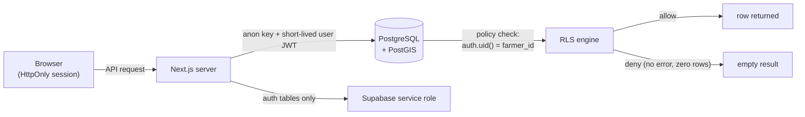

# Row Level Security Policies

**Status: initial policies exist** in `supabase/migrations/`. Authentication
tables are server-only and have RLS enabled without client policies. This
document describes the intended policy model; migrations are authoritative.

Companion to [`data-model.md`](./data-model.md).

---

## 1. The principle

**RLS is the authorisation boundary. Application checks are a UX convenience,
not the boundary.**

With RLS, a forgotten `where farmer_id = ?` in a query cannot leak data,
because the policy rejects the row regardless of what the query asked for.
With an application-enforced model, every future query is a potential leak
and every future contributor has to remember.

For this project specifically: three people, an AI coding agent writing code,
and a 48-hour build. **The design should make the safe path the default path.**

---

## 2. How RLS works here



**Key property:** a denied row produces an **empty result, not an error**. A
`SELECT` returns zero rows; an `INSERT`/`UPDATE`/`DELETE` affects zero rows.
The application cannot tell the difference between "does not exist" and "not
yours" (which is the correct behaviour, and prevents existence disclosure).

---

## 3. The identity anchor

`auth.uid()` returns the authenticated user's UUID from the short-lived,
server-signed database JWT. The server issues that token only after verifying
the opaque session against `local_sessions`. Every
farmer-scoped table stores `farmer_id` (or derives it through a parent) so
that the policy is a single equality check.

**`profiles.id = local_accounts.id`**: the profile row and application account
share a stable UUID, which is the JWT `sub` and RLS identity.

---

## 4. Policies by table

> The SQL below is **illustrative and must be verified against the actual
> PostGIS/PostgreSQL behaviour before it is applied.** It states the intent
> precisely; the Phase 2 migration is the authority.

### 4.1 `profiles`

```sql
ALTER TABLE profiles ENABLE ROW LEVEL SECURITY;

-- A user may read and update only their own profile.
CREATE POLICY profiles_select_own ON profiles
  FOR SELECT USING (id = auth.uid());

CREATE POLICY profiles_update_own ON profiles
  FOR UPDATE USING (id = auth.uid()) WITH CHECK (id = auth.uid());

-- No INSERT policy: profile creation is performed by server-side registration.
-- No DELETE policy: account deletion goes through a controlled path.
```

**Note the deliberate absence of an `INSERT` policy.** The server creates the
profile after creating the account. The service-role use is limited to
authentication records; all later profile reads and updates use a
user-scoped token and RLS.

### 4.2 `farms`

```sql
ALTER TABLE farms ENABLE ROW LEVEL SECURITY;

CREATE POLICY farms_select_own ON farms
  FOR SELECT USING (farmer_id = auth.uid());

CREATE POLICY farms_insert_own ON farms
  FOR INSERT WITH CHECK (farmer_id = auth.uid());

CREATE POLICY farms_update_own ON farms
  FOR UPDATE USING (farmer_id = auth.uid()) WITH CHECK (farmer_id = auth.uid());

CREATE POLICY farms_delete_own ON farms
  FOR DELETE USING (farmer_id = auth.uid());
```

**The `WITH CHECK` clause is the important one.** `USING` filters which rows
can be read or modified; `WITH CHECK` validates the rows *after* the
modification. Without `WITH CHECK`, a user could update their own farm and
set `farmer_id` to someone else's, **transferring the farm out of their
control and into someone else's**. This is the single most common RLS
mistake.

### 4.3 `parcels`

```sql
ALTER TABLE parcels ENABLE ROW LEVEL SECURITY;

CREATE POLICY parcels_all_own ON parcels
  FOR ALL USING (
    EXISTS (
      SELECT 1 FROM farms f
      WHERE f.id = parcels.farm_id AND f.farmer_id = auth.uid()
    )
  )
  WITH CHECK (
    EXISTS (
      SELECT 1 FROM farms f
      WHERE f.id = parcels.farm_id AND f.farmer_id = auth.uid()
    )
  );
```

`parcels` has no `farmer_id` of its own; ownership is inherited from the
parent farm. The `EXISTS` subquery is the inheritance mechanism.

### 4.4 `farm_crops`

```sql
ALTER TABLE farm_crops ENABLE ROW LEVEL SECURITY;

CREATE POLICY farm_crops_all_own ON farm_crops
  FOR ALL USING (
    EXISTS (
      SELECT 1 FROM farms f
      WHERE f.id = farm_crops.farm_id AND f.farmer_id = auth.uid()
    )
  )
  WITH CHECK (
    EXISTS (
      SELECT 1 FROM farms f
      WHERE f.id = farm_crops.farm_id AND f.farmer_id = auth.uid()
    )
  );
```

Same inheritance pattern.

### 4.5 `farm_priorities`

Same pattern as `parcels`.

### 4.6 `crops`, `data_sources`, `recommendation_rulesets`

**Public reference data.** Readable by everyone; writable by nobody through
the client.

```sql
ALTER TABLE crops ENABLE ROW LEVEL SECURITY;
CREATE POLICY crops_read ON crops FOR SELECT USING (true);
-- No INSERT/UPDATE/DELETE policies: only the service role (seed script) writes.
```

The same applies to `data_sources` and `recommendation_rulesets`.

### 4.7 `environmental_observations`

**This one needs care.** Observations are per-farm, so most rows are
farmer-scoped. But some are pre-computed regional values shared by many farms.

```sql
ALTER TABLE environmental_observations ENABLE ROW LEVEL SECURITY;

CREATE POLICY observations_read_shared_or_own ON environmental_observations
  FOR SELECT USING (
    parcel_id IS NULL                                -- shared grid reference
    OR EXISTS (
      SELECT 1 FROM parcels p
      JOIN farms f ON f.id = p.farm_id
      WHERE p.id = environmental_observations.parcel_id AND f.farmer_id = auth.uid()
    )
  );
```

**[Proposed]** Writes to this table happen **only** through the service role
(the ingestion path), never from the browser. No `INSERT` policy is defined
for the `authenticated` role.

**Rationale:** an observation row is a scientific data record with provenance.
Allowing a client to insert one would let a farmer fabricate their own
"measurement". The farmer's own inputs (crop records, soil notes, priorities)
are theirs to edit; the *observations* are ours.

### 4.8 `analyses`, `recommendations`, `rotation_strategies`, `rotation_legs`

All farmer-scoped through the parent farm.

```sql
-- analyses
CREATE POLICY analyses_all_own ON analyses
  FOR ALL USING (
    EXISTS (SELECT 1 FROM farms f WHERE f.id = analyses.farm_id AND f.farmer_id = auth.uid())
  )
  WITH CHECK (
    EXISTS (SELECT 1 FROM farms f WHERE f.id = analyses.farm_id AND f.farmer_id = auth.uid())
  );

-- recommendations
CREATE POLICY recommendations_read_own ON recommendations
  FOR SELECT USING (
    EXISTS (SELECT 1 FROM farms f WHERE f.id = recommendations.farm_id AND f.farmer_id = auth.uid())
  );

-- rotation_strategies
CREATE POLICY rotation_strategies_all_own ON rotation_strategies
  FOR ALL USING (
    EXISTS (SELECT 1 FROM farms f WHERE f.id = rotation_strategies.farm_id AND f.farmer_id = auth.uid())
  )
  WITH CHECK (
    EXISTS (SELECT 1 FROM farms f WHERE f.id = rotation_strategies.farm_id AND f.farmer_id = auth.uid())
  );

-- rotation_legs: ownership inherited from the strategy
CREATE POLICY rotation_legs_all_own ON rotation_legs
  FOR ALL USING (
    EXISTS (
      SELECT 1 FROM rotation_strategies rs
      JOIN farms f ON f.id = rs.farm_id
      WHERE rs.id = rotation_legs.strategy_id AND f.farmer_id = auth.uid()
    )
  )
  WITH CHECK (
    EXISTS (
      SELECT 1 FROM rotation_strategies rs
      JOIN farms f ON f.id = rs.farm_id
      WHERE rs.id = rotation_legs.strategy_id AND f.farmer_id = auth.uid()
    )
  );
```

**Recommendations and rotation strategies are read-only to the farmer.**
They are outputs of the analysis engine, not the farmer's own input. If the
farmer disagrees, they change their input (the crop, the priorities) and the
engine re-runs. This keeps the audit trail clean: a stored recommendation
always corresponds to a stored analysis with a stored ruleset version.

### 4.9 `reports`

```sql
CREATE POLICY reports_all_own ON reports
  FOR ALL USING (
    EXISTS (SELECT 1 FROM farms f WHERE f.id = reports.farm_id AND f.farmer_id = auth.uid())
  )
  WITH CHECK (
    EXISTS (SELECT 1 FROM farms f WHERE f.id = reports.farm_id AND f.farmer_id = auth.uid())
  );
```

### 4.10 `external_cache`, `grid_cells`, `soil_properties`

**Internal.** No policies for the `authenticated` role: the service role
bypasses RLS, and the browser has no business reading the raw cache.

```sql
ALTER TABLE external_cache ENABLE ROW LEVEL SECURITY;
-- No policies for `authenticated`. The service role bypasses RLS.
```

**[Proposed]** `grid_cells` and `soil_properties` are reference data and may be
readable, but there is no need to expose them: the browser gets exactly the
cells a farm needs through the farm's observations.

---

## 5. The service role

| Rule                                                                | Reason                                                        |
| ------------------------------------------------------------------- | ------------------------------------------------------------- |
| Never in `NEXT_PUBLIC_*`                                            | It bypasses RLS entirely                                      |
| Never used to serve a user request directly                         | A user request must go through RLS, or the boundary is void  |
| Used only for: background refresh jobs, seeding, admin operations   | A closed set of operations                                    |
| Read from a server-only module                                      | `import "server-only"` makes a client import a build error    |
| Rotate if it ever leaks                                             | It is the most dangerous secret in the project                |

`external_cache` has RLS enabled and no authenticated policies. Environmental
observations also have no authenticated write policy. Cache refresh and
observation ingestion therefore remain trusted server-side operations.

**A service-role client is created in exactly one place**, in
`lib/supabase/admin.ts`, so there is a single audit point.

---

## 6. Testing strategy

**[Proposed] The isolation test is the most important test in the project.**

| Test                                                          | Proves                                                       |
| ------------------------------------------------------------- | ------------------------------------------------------------ |
| User A creates a farm; User B queries `farms`                 | B receives **zero rows**                                      |
| User A updates their farm, setting `farmer_id = B`            | The `WITH CHECK` clause **rejects** the update                |
| User A inserts a farm with `farmer_id = B`                     | The insert **fails**                                          |
| User A queries `crops`                                        | Returns the reference catalog: public data is readable       |
| User A inserts into `environmental_observations`              | **Fails**: no insert policy                                   |
| User A queries `external_cache`                               | Returns **zero rows**                                         |
| The anon key, used outside any application code, queries a farm | Returns zero rows, proving the boundary is in the database, not the app |

**The last test is the most valuable.** It proves that RLS is genuinely the
boundary: even a completely separate client using only the public anon key
cannot read another farmer's data.

**Implementation:** two Supabase clients authenticated as two different test
users, against a test project.

---

## 7. Roles beyond `farmer`

**[Proposed]** The role model exists so extension workers can be added
without a schema change, but **no non-farmer workflow is designed in the MVP.**

| Role              | Own farms | Assigned farms | Aggregated multi-farm view | Reference data | Admin |
| ----------------- | --------- | ------------- | -------------------------- | -------------- | ----- |
| `farmer`          | ✔         | n/a           | ✘                          | ✔              | ✘     |
| `extension_worker`| ✔         | ✔             | ✔ (assigned only)          | ✔              | ✘     |
| `researcher`      | ✔         | n/a           | ✔ (de-identified aggregates)| ✔              | ✘     |
| `admin`           | ✔         | ✔             | ✔                          | ✔              | ✔     |

**Implementation approach [Proposed]:** keep the `profiles.role` column for
Phase 1. When a second role is genuinely needed, add a
`farmer_role_assignments` table (user → farm, with a role) rather than
overloading `profiles.role`. Supporting multiple roles per user is
eventually necessary and is cheap to add later; building it now is not.

---

## 8. Performance considerations

RLS adds a predicate to every query. On small tables this is negligible.

| Concern                          | Mitigation                                                         |
| -------------------------------- | ------------------------------------------------------------------ |
| Policy subqueries per row        | The `EXISTS` subquery on `farms` uses the PK index: cheap.       |
| RLS preventing index usage       | The policy is on `farmer_id`/`id`, which are indexed.              |
| `USING` on large observation tables | Keep the `farm_id` b-tree index current; it already exists.      |
| Service-role bypass              | Use it for bulk reads where RLS would add cost without benefit.   |

**[Proposed]** A useful optimisation: policy subqueries can be replaced with a
`security definer` helper function that reads the farmer's farm ids once per
statement. Worth doing only if profiling shows it matters. At MVP scale it
will not.

---

## 9. Checklist before the first user-facing migration

- [ ] PostGIS enabled on the project.
- [ ] All tables created **with** their RLS enabled in the same migration.
- [ ] Policies written for every table.
- [ ] `WITH CHECK` present on every `INSERT`/`UPDATE` policy.
- [ ] The cross-account isolation test passes.
- [ ] First-party registration creates both the account and profile.
- [ ] Account/session/rate-limit tables have RLS enabled and no client policies.
- [ ] The service-role client exists in exactly one place, marked
      `server-only`.
- [ ] No policy grants write access to `environmental_observations`,
      `analyses`, `recommendations` or `rotation_strategies` for the
      `authenticated` role.
- [ ] The Supabase dashboard's table editor is **not** used to create
      anything.
