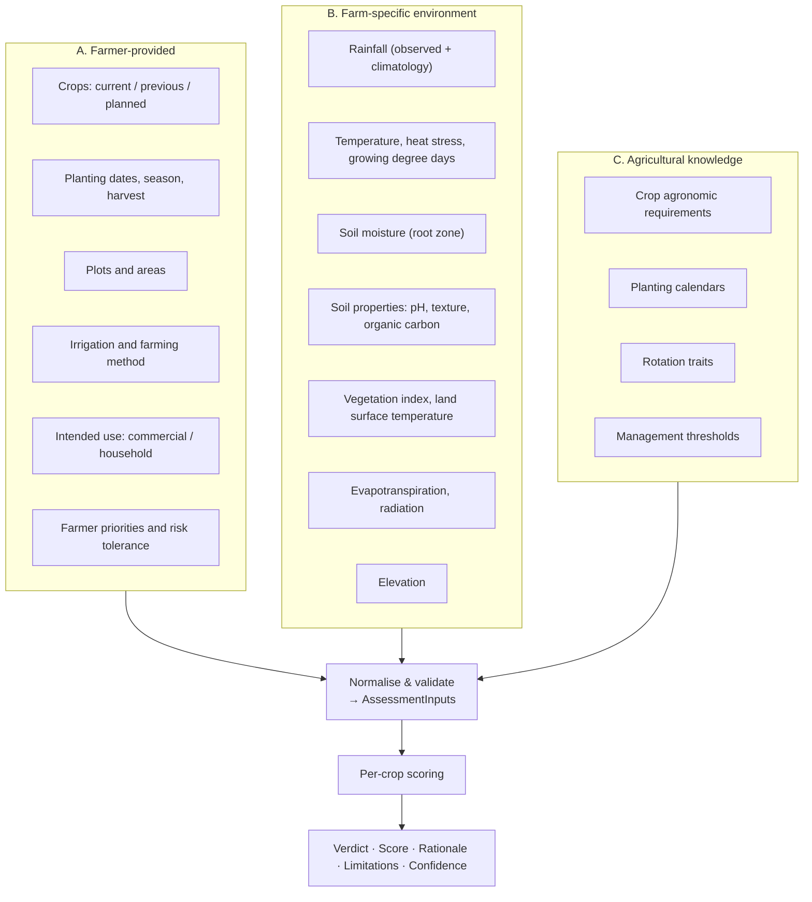
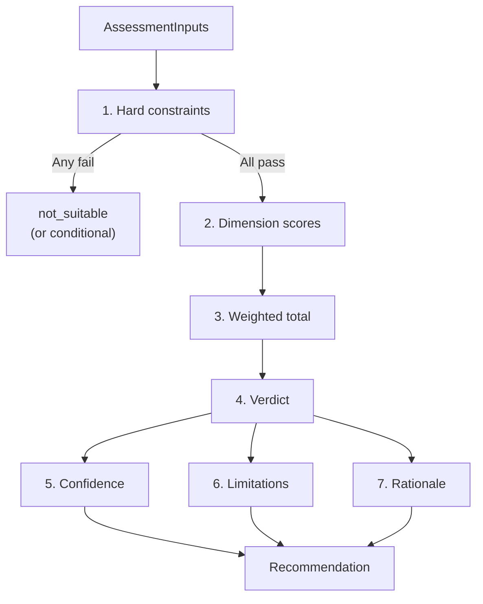
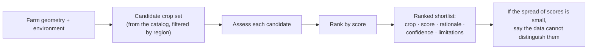

# Recommendation Methodology

**Status: Phase 1 — the method is specified; the thresholds are not yet set.**

Companion: [`ADR-0004`](../decisions/ADR-0004-rules-based-recommendation-engine.md) ·
[`data-sources.md`](../api/data-sources.md) · [`../../PRD.md`](../../PRD.md) FR-5

---

## 1. What a recommendation is

A **recommendation** is a conclusion with four mandatory components:

| Component        | What it contains                                                                |
| ---------------- | ------------------------------------------------------------------------------- |
| **Verdict**      | `suitable` \| `conditional` \| `not_suitable` \| `insufficient_information`      |
| **Score**        | 0–1, from the weighted dimension scores. **Null** when the verdict is `insufficient_information`. |
| **Rationale**    | Human-readable reasoning that cites the inputs it used                          |
| **Limitations**  | An explicit list of what is unknown, coarse, stale or contested                  |
| **Confidence**   | 0–1, computed **separately** from the score                                     |

Plus `ruleset_version` — the version of the rules that produced it.

**[Confirmed]** The platform must communicate a limitation rather than invent
an answer. `insufficient_information` is a first-class outcome, not an error
and not a fallback.

---

## 2. The three information categories

The brief is explicit that recommendations combine three categories rather
than relying on a single dataset.



**[Proposed] Why the combination matters, concretely.** Rainfall alone cannot
tell you whether to plant maize — it can only tell you the season looks wet.
But rainfall **plus irrigation method** tells you whether water is the binding
constraint. And rainfall plus **the farmer's priority** (yield vs. risk) tells
you which of two viable crops to recommend. Each category changes the answer.

---

## 3. The assessment pipeline



### 3.1 Hard constraints

A hard constraint is a threshold outside which the crop is not viable. Any
failure produces `not_suitable` (or `conditional` where the failure is
mitigable) regardless of the score.

| Constraint                | Source of the threshold                      | Source of the value                        |
| ------------------------- | -------------------------------------------- | ------------------------------------------- |
| Soil pH outside range     | Crop requirement catalog                      | SoilGrids (250 m, interpolated, uncertain)  |
| Soil texture unsuitable   | Crop requirement catalog                      | SoilGrids                                   |
| Annual rainfall below minimum | Crop requirement catalog                   | POWER climatology / CHIRPS                  |
| Temperature outside range | Crop requirement catalog                      | POWER climatology                           |
| Growing season too short  | Crop requirement catalog                      | POWER climatology + planting calendar        |
| Water demand unmet        | Crop requirement catalog                      | POWER rainfall + the farm's irrigation method |

**[Proposed]** Hard constraints are evaluated first because they are cheap and
decisive, and because a high score on a soft dimension must never override a
hard failure.

**[Proposed] Where a constraint's *evidence* is weak** — for example, soil pH
from a 250 m interpolated grid with a wide uncertainty band — the constraint
should downgrade to `conditional` rather than produce a hard `not_suitable`.
**A constraint that is uncertain should not be decisive.** This is the rule
that keeps the system honest.

### 3.2 Scored dimensions

Each dimension is scored 0–1 and then weighted.

| Dimension             | What it measures                                                         | Primary inputs                          |
| --------------------- | ------------------------------------------------------------------------ | --------------------------------------- |
| **Climate match**     | Rainfall and temperature against the crop's requirement band             | POWER / CHIRPS climatology + catalog    |
| **Season timing**     | Whether the planting window aligns with the local rainy-season onset      | Crop calendar + POWER rainfall onset     |
| **Water availability** | Whether water supply meets the crop's demand, given the irrigation method | POWER rainfall + `farm.irrigation_method` |
| **Soil match**        | Soil texture, pH and organic carbon against the crop's preference        | SoilGrids + catalog                      |
| **Vegetation condition** | Current NDVI/EVI against the expected stage for the crop and season    | MODIS / Landsat / Sentinel-2            |
| **Risk exposure**     | Drought, flood and heat-stress exposure over the relevant period          | POWER time series + crop sensitivity      |
| **Rotation fit**      | How well the crop fits the existing rotation (nitrogen, residue, disease break) | Crop catalog `rotation_traits` + farm history |

**[Proposed]** Weights are **per crop**, because the importance of a dimension
depends on the crop. Irrigation advice is irrelevant for a fully rainfed
millet crop in a dry year; waterlogging risk dominates for rice.

### 3.3 Weighting and priorities

The farmer's stated priorities (FR-2.13) shift the weights.

| Stated priority        | Effect on the weighting                                                   |
| ---------------------- | ------------------------------------------------------------------------- |
| Improve soil fertility | Raise the weight on soil match and on rotation fit                         |
| Conserve water         | Raise the weight on water availability; penalise high water demand        |
| Increase income        | Raise the weight on yield potential (climate match) and market suitability |
| Food security          | Raise the weight on reliability and risk avoidance over peak yield        |
| Less work              | **[Proposed]** Raise the weight on the similarity to the existing rotation |

**[Proposed]** The farmer's priorities must be **visible in the output** —
"this recommendation ranks higher because you said you want to conserve
water". A recommendation that silently re-weights is not explainable.

### 3.4 Verdict thresholds

**[Proposed]** The thresholds below are a starting structure. **The exact
values require agronomic review and are not fixed in Phase 1.**

| Verdict                  | Condition                                                                  |
| ------------------------ | -------------------------------------------------------------------------- |
| `suitable`               | No hard constraint failed; total score ≥ 0.7; confidence ≥ 0.6              |
| `conditional`            | No hard constraint failed; 0.4 ≤ total < 0.7; **or** a constraint failed but is uncertain or mitigable |
| `not_suitable`           | A hard constraint failed with confident evidence                             |
| `insufficient_information`| A required input is missing, or the available evidence is too coarse or too incomplete to discriminate |

**[Proposed] A note on the score thresholds.** Thresholds like 0.7 are
arbitrary until the ruleset has been tested against real farms. The honest
approach for the MVP: set them, label them as provisional in the ruleset, and
record the version. Changing them later is a ruleset version bump — which is
exactly why the version exists.

### 3.5 Confidence

**Confidence is not the score.** A high score with poor data is not a
confident answer.

```
confidence = completeness × resolution_factor × recency_factor × constraint_certainty
```

| Factor                | Definition                                                                    |
| --------------------- | ------------------------------------------------------------------------------ |
| **completeness**      | Fraction of the required inputs that are present                              |
| **resolution_factor** | How well the available data's resolution matches the farm. For a 1.4 ha farm: Landsat/Sentinel-2 ≈ 1.0; MODIS 250 m ≈ 0.6; SMAP 9 km ≈ 0.2; POWER 55 km ≈ 0.1 |
| **recency_factor**    | Decays with the age of the observation, relative to the crop's decision horizon |
| **constraint_certainty** | 1.0 when the binding constraint was evaluated against high-resolution data; lower when it was evaluated against a coarse interpolation |

**[Proposed] The `resolution_factor` is the most important number in the
system.** It is the mechanism that stops the product from being confident
about a 9 km soil-moisture value on a 1.4 ha field. It is also the clearest
expression of the product's honesty principle in code.

### 3.6 Limitations

Every recommendation carries an explicit limitations list. Sources of
limitations:

| Limitation                                | Example wording                                                        |
| ----------------------------------------- | ------------------------------------------------------------------------ |
| Coarse resolution                         | *"Soil moisture is estimated for the 9 km area around your farm, not for your field."* |
| Missing data                              | *"Rainfall data for July 2026 is missing for this area."*               |
| Staleness                                 | *"This rainfall figure is from 12 days ago."*                            |
| Modelled value                            | *"Soil pH is an interpolated model estimate, not a measurement."*        |
| Partial coverage                          | *"Only 60% of your field had usable satellite imagery this period."*     |
| Unknown farmer input                      | *"Your irrigation method is not recorded, so water availability could not be assessed properly."* |
| Unverifiable requirement                  | *"This recommendation uses a crop requirement from a general reference, not from local Tofa practice."* |
| Needs local review                         | *"This should be checked with an agricultural extension officer before you act on it."* |

**[Proposed]** The limitations are not an apology at the bottom of the screen.
**They are part of the recommendation.** The UI presents verdict, rationale
and limitations together.

---

## 4. Crop suitability assessment (prospective farmers)

**[Confirmed]** A farmer with no crop selected receives a **suitability
assessment** rather than a crop recommendation.



**[Proposed] The spread rule.** If the top two candidates differ by less than
a small margin, the platform says the data **cannot distinguish them** and
says what would help. This is the honest form of the answer, and it prevents
a spurious ranking.

**[Proposed] The candidate set** comes from the catalog filtered by
geographic plausibility (a crop catalogued for the Sahel, not for the
Arctic). **[Proposed]** The catalog must carry a `region` or `applicable_regions`
field for this to work.

---

## 5. Rotation strategy comparison

**[Confirmed]** Required by the NASA Space Apps "Field Shift" challenge brief.

> *"You may compare at least three rotation strategies, including the existing
> rotation. For each strategy, you may explain why it was suggested, what
> evidence supports it, what benefits it may offer, where information gaps
> exist, and any risks that would need local review by farmers or agricultural
> experts."*

### 5.1 What a rotation strategy is

```typescript
interface RotationStrategy {
  kind: "existing" | "alternative";
  label: string;
  legs: Array<{
    sequence: number;
    season: "rainy" | "dry" | "harmattan" | "year_round";
    cropId: string;
    plotId: string | null;
    areaHa: number | null;
    cropAssessment: {
      verdict: RecommendationVerdict;
      score: number;
      confidence: number;
      limitations: string[];
    };
  }>;
  rationale: string;          // WHY it was suggested
  evidence: EvidenceItem[];   // WHAT supports it
  benefits: string[];         // WHAT benefits it may offer
  informationGaps: string[];  // WHERE information gaps exist
  localReviewRisks: string[]; // RISKS needing local review
  score: number;
  confidence: number;
}
```

**The four text fields map one-to-one onto the challenge brief's wording.**
That is deliberate: it makes the submission visibly compliant, and it forces
the content to be honest — you cannot fill "evidence" without having evidence.

### 5.2 How a strategy is built

1. **Start from the farm's crop history** to identify the existing rotation
   (the crops, their seasons and their order).
2. **Generate alternatives** by applying rotation rules to the crop catalog:
   - A legume after a cereal (nitrogen contribution).
   - A cereal after a legume (uses the nitrogen, heavy feeder).
   - A cash crop where the farmer's priority is income.
   - A drought-tolerant crop where the rainfall outlook is poor.
   - A high-water-demand crop only where irrigation is available.
3. **Assess every crop in every candidate strategy** with the same engine
   used for a single-crop recommendation. **Consistency matters**: the crop
   scores in a rotation must be the same crop scores shown elsewhere.
4. **Apply rotation-level rules**: sequence effects, seasonal coverage, risk
   spread.
5. **Weight by the farmer's priorities.**
6. **Attach the four required fields.**

### 5.3 The honesty constraints on rotation advice

**[Proposed] This is the highest-risk part of the product.** A wrong rotation
recommendation can cost a farmer a season. Therefore:

| Constraint | Implementation |
| ---------- | -------------- |
| The existing rotation is always presented first and on equal terms | `kind: "existing"` sorts first; the UI never labels it "your current, suboptimal rotation" |
| Every strategy carries the local-review statement | `localReviewRisks` always includes the "requires local review by an agricultural expert" item |
| Rotation claims cite the crop requirements used | `evidence` items carry the same citation structure as the catalog |
| The information gaps are explicit | `informationGaps` is populated from the actual per-crop limitations, not generated boilerplate |
| No claim of a yield improvement | The product does not predict yield. It states suitability and the agronomic reasons, not outcomes |

**[Proposed]** The last row is deliberate and important. Saying *"this
rotation will increase your yield by 20%"* is the kind of claim we cannot
support with the available data and should never make. Saying *"a legume
following millet may support soil nitrogen, based on the nitrogen
requirement recorded in the crop catalog for these two crops"* is supportable.

---

## 6. The crop catalog

**[Proposed]** Crop requirements live in a **versioned JSON/TypeScript file
in the repository**, seeded into the `crops` table. Not fetched from an API at
runtime.

### 6.1 Why versioned in the repository

- **Auditable** — a judge can read the requirements for millet.
- **Correctable** — a wrong threshold is a one-line edit and a ruleset
  version bump.
- **Offline** — the demo does not depend on a third-party catalog API.
- **Diffable** — a PR shows exactly which requirement changed and why.

### 6.2 The entry format

```typescript
interface CropRequirements {
  code: string;                    // "millet"
  name: string;
  category: "cereal" | "legume" | "vegetable" | "root" | "tuber" | "cash_crop";
  applicableRegions: string[];    // ["sahel", "west_africa"]
  growingPeriodDays: { min: number; max: number };
  temperature: { optimalMin: number; optimalMax: number; absoluteMin: number; absoluteMax: number };
  rainfall: { minMm: number; maxMm: number; seasonLengthDays: number };
  waterDemand: { mmPerDay: number; irrigationRequired: boolean };
  soil: {
    ph: { min: number; max: number };
    preferredTexture: ("sand" | "loam" | "clay" | "silt")[];
    drainage: ("poor" | "moderate" | "good" | "excellent")[];
  };
  plantingWindow: { startDayOfYear: number; endDayOfYear: number };
  gdd: { baseTemperatureC: number; requiredGdd: number };
  rotationTraits: {
    nitrogenContribution: "fixes" | "consumes" | "neutral";
    residueLoad: "low" | "medium" | "high";
    diseaseBreak: boolean;
  };
  sourceCitations: Array<{ claim: string; sourceUrl: string; accessedOn: string }>;
}
```

### 6.3 The citation rule

**Every agronomic value must cite a source.** An uncited requirement is a
defect, and the database enforces it:

```sql
CHECK (jsonb_array_length(source_citations) > 0)
```

**[Proposed]** Where a requirement comes from a general reference rather than
local Tofa practice, the recommendation's limitations should say so. That
sentence is the difference between a citation and an honest citation.

---

## 7. The ruleset

```typescript
interface Ruleset {
  version: string;                  // "2026.11.1"
  thresholds: {
    suitableScore: number;
    conditionalScore: number;
    minimumConfidence: number;
    indistinguishableMargin: number;
  };
  weights: Record<string, Record<string, number>>;  // crop → dimension → weight
  constraints: ConstraintRule[];
  rotationRules: RotationRule[];
  texts: {
    confidenceFactors: Record<string, string>;
    standardLimitations: Record<string, string>;
  };
}
```

**[Proposed]** `weights` are per crop. `texts` holds the user-facing strings so
that a ruleset change can improve wording without touching code — and so that
the wording is reviewable by the team, not by an engineer.

**Versioning:** the ruleset version is stored on every recommendation. A
recommendation from `2026.11.1` is reproducible: the ruleset is immutable once
published.

---

## 8. Worked example — an honest answer

**Farm:** 1.4 ha in Tofa LGA. Farmer grows millet, plans cowpea. Rainfed. No
irrigation recorded.

| Stage              | Result                                                                        |
| ------------------ | ----------------------------------------------------------------------------- |
| Hard constraints   | Millet: annual rainfall (810 mm vs 600–1200 mm required) passes. Cowpea: passes. |
| Climate match      | Millet 0.82 — the season's rainfall is within band. Cowpea 0.74.            |
| Season timing      | Millet 0.88 — the planting window aligns with the local onset (12 May). Cowpea 0.71. |
| Water availability | Millet 0.55 — rainfed, and the season's rainfall is 14% below normal. Cowpea 0.61 — lower water demand. |
| Soil match         | Millet 0.70 — SoilGrids pH 6.2 (interpolated; wide uncertainty band). Cowpea 0.78 — pH 6.4 preferred. |
| Vegetation         | Millet 0.60 — the latest 16-day NDVI composite is at the low end of the field's own history. |
| Weighted total     | Millet **0.74**, Cowpea **0.71**                                            |
| Verdict            | Millet **conditional**, Cowpea **conditional**                                |
| Confidence         | Millet **0.42** — the binding constraints are rainfall (regional, 55 km) and soil pH (250 m, interpolated) |
| Limitations        | *"Rainfall is a regional figure covering about 55 km. Soil pH is an interpolated estimate for a 250 m cell, and the model is uncertain there. The planting window is from a general reference, not from local Tofa practice."* |
| Rationale          | *"Millet fits the rainfall and temperature this season. The season's rainfall is 14% below the long-term average for this area, and your field is unirrigated, so late planting carries more risk than usual. Cowpea needs less water and may suit the drier part of the season. Check both with an agricultural extension officer before you decide."* |

**Note what this answer does not say.** It does not say the field's soil
moisture is 18%. It does not predict a yield. It does not claim that millet is
"wrong" for this farm. It says what fits, how confident the platform is, and
what it does not know.

---

## 9. What the method explicitly does not do

| Not done | Why |
| -------- | --- |
| Predict yield | Not supportable with these data sources at field scale |
| Recommend a specific variety | Needs local variety trials and market information we do not have |
| Diagnose a disease from imagery | Requires crop-type identification and expert ground truth |
| Give a spray or input schedule | Requires field-level phenology and product information |
| Forecast weather | That is a forecast product; we observe the past |
| Use an LLM to decide anything | See [ADR-0004](../decisions/ADR-0004-rules-based-recommendation-engine.md) |

---

## 10. Validation plan

**[Proposed]** The method must be validated against real farms before it is
trusted.

| Step | Activity                                                      | Output                                        |
| ---- | ------------------------------------------------------------- | --------------------------------------------- |
| 1    | Interview farmers in Tofa about their actual crops, timing and decisions | A ground-truth table of what farmers actually do |
| 2    | Compare the platform's "existing rotation" detection against it | A measure of whether the platform understands the farm at all |
| 3    | Ask farmers to interpret a sample recommendation out loud      | Whether the language is understood            |
| 4    | Ask whether they would act on it, and what they would change    | The honest test of usefulness                 |
| 5    | Record every disagreement and treat it as a ruleset bug        | The version bump list                          |

**[Proposed]** Step 5 is the mechanism that keeps the methodology honest over
time. A recommendation the farmer says is wrong is a defect in the ruleset,
not a misunderstanding by the farmer.
