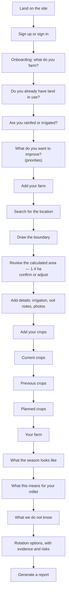
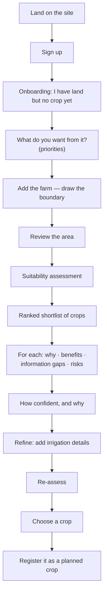
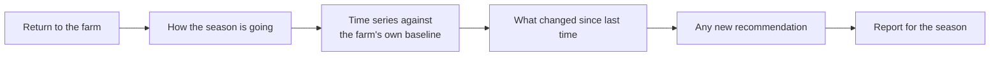
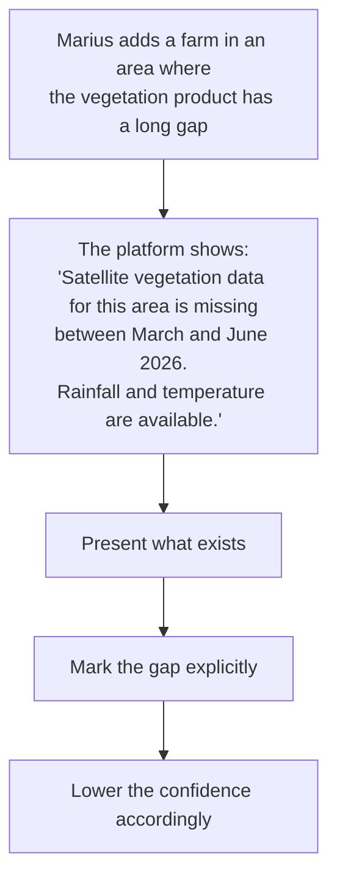
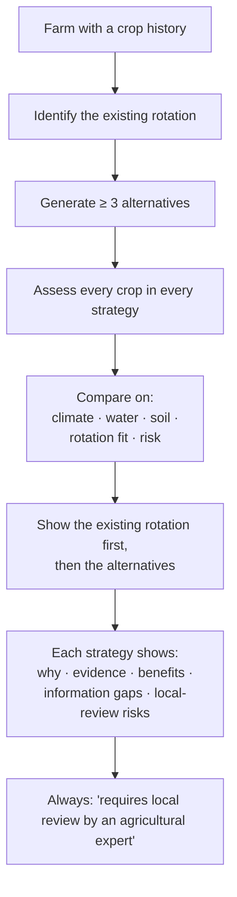

# User Flows

**Status: Phase 1 — the flows are specified; they are not implemented.**

Companion: [`../../PRD.md`](../../PRD.md) § 10 ·
[`recommendation-methodology.md`](./recommendation-methodology.md)

---

## 1. The three modes

The product serves three distinct situations. Treating them as one flow is
the most common design mistake in agricultural platforms.

| Mode                    | Who                          | The question                       | The answer                                    |
| ----------------------- | ---------------------------- | ---------------------------------- | --------------------------------------------- |
| **A — Existing farmer** | Cultivates the land now      | "How do I do this better?"         | Per-crop management guidance for the current season |
| **B — Prospective farmer** | Has land, no crop chosen   | "What should I plant?"             | A ranked, explained crop shortlist            |
| **C — Returning farmer** | Comes back later             | "What has changed?"                | Monitoring, season-over-season comparison      |

**[Proposed]** Mode is determined at onboarding and reflected in the dashboard
structure. It is **not** a toggle on the dashboard — the information hierarchy
differs. See PRD OQ-2.

---

## 2. Flow A — the existing farmer

### Step-by-step detail

| Step | Screen                | What the farmer does                                     | What the system does                                       |
| ---- | --------------------- | -------------------------------------------------------- | ---------------------------------------------------------- |
| 1    | Landing              | Understands the proposition                                | States plainly what it uses and what it cannot do           |
| 2    | Auth                 | Creates an account or signs in                            | Supabase Auth; a `profiles` row is created by trigger       |
| 3    | Onboarding — crops   | Taps their crops from a searchable list                   | Stores `farm_crops` with `status`                          |
| 4    | Onboarding — land    | Says whether the land is in use                            | Sets the mode                                              |
| 5    | Onboarding — water   | Says rainfed or irrigated, and how                        | Stores `irrigation_method` — a direct input to the water dimension |
| 6    | Onboarding — goals   | Taps their priorities                                    | Stores `farm_priorities` — weights the recommendation      |
| 7    | Add farm — map       | Searches, pans, draws                                     | Computes an area **preview** with Turf                      |
| 8    | Add farm — confirm   | Checks the area, adjusts the polygon if needed            | **PostGIS computes the authoritative area**                 |
| 9    | Add farm — details   | Optionally adds irrigation, soil notes, a photo           | Stores them; marks the data as complete or incomplete       |
| 10   | Crops                | Adds current, previous and planned crops with dates       | Stores `farm_crops`                                        |
| 11   | Farm dashboard       | Reads their farm                                          | Fetches and caches observations; computes the analysis      |
| 12   | Recommendations      | Reads the guidance and its limitations                    | Runs the rules engine; stores the recommendation            |
| 13   | Rotations            | Compares strategies                                       | Generates the existing rotation plus ≥ 3 alternatives       |
| 14   | Report               | Generates or shares a report                              | Renders and stores a report with attribution               |

### The critical moment: step 8

The area the farmer sees after drawing must be **the area that gets stored**.
The browser computes a preview; the database computes the truth. If they
disagree beyond a small tolerance, the farmer is shown the database value and
told the boundary was adjusted — not silently overridden.

### The second critical moment: step 12

The farmer must not be able to mistake a regional figure for a field
measurement. The UI distinguishes three cases, in plain language:

| Case                              | Wording                                                            |
| --------------------------------- | ------------------------------------------------------------------ |
| Measured over the farm            | *"Measured over your field"* (Landsat, Sentinel-2, MODIS zonal)    |
| Estimated for the surrounding area| *"An estimate for the 9 km area around your farm"* (SMAP)            |
| A regional climate figure        | *"A regional figure covering about 55 km"* (POWER)                 |

---

## 3. Flow B — the prospective farmer

### The key difference from Flow A

**The output is a list, not an answer.** And the list must say what it cannot
distinguish.

**[Proposed] The spread rule.** If the top two candidates are within the
`indistinguishableMargin`, the interface says:

> *"Millet and cowpea score almost the same on the data available for this
> area. The rainfall record here is regional, so it cannot separate them.
> If you tell us how you would irrigate, or what you want from the crop, the
> comparison gets sharper."*

That sentence is more useful than a false ranking.

---

## 4. Flow C — monitoring

**[Proposed] Two baselines, always together:**

1. **The farm's own record** — this farm, this crop, previous seasons.
2. **The climate climatology** — the multi-year average for the grid cell.

A rainfall bar chart on its own is not actionable. *"June was 14% below the
long-term average for this area"* is.

**[Proposed]** The interface must distinguish "no data" from "no change". A
flat line through a cloud gap is a lie. See § 5.

---

## 5. The flow that proves the product is honest

**This is a first-class requirement, not an edge case.**

**[Proposed] What this must never look like:**

- A flat line through the gap (implies no change).
- A zero (implies no vegetation).
- An interpolated value with no label (implies observation).

**What it must look like:** the available series, a visible gap band, a plain
sentence naming the gap, and a reduced confidence on the affected
recommendation.

---

## 6. Flow D — the rotation comparison

**Added for the NASA Space Apps "Field Shift" challenge brief.**

**[Proposed] The presentation order is deliberate.** The existing rotation is
first and is never framed as the "bad" option. The alternatives are
*different*, not *better*. A platform that tells a farmer their current
practice is wrong is making a claim it cannot support.

---

## 7. Cross-cutting states

Every data view implements four states. This is a checklist item, not a
detail.

| State      | Treatment                                                                       |
| ---------- | ------------------------------------------------------------------------------- |
| **Loading**| A skeleton that matches the final layout's shape. **Not a spinner over blank space.** |
| **Empty**  | Explains what would appear and how to get it: *"No rainfall data for this farm yet. Open the farm and refresh."* |
| **Error**  | Says what happened and what to do: *"NASA POWER is temporarily unavailable. Your farm and crops are saved. Try again in a few minutes."* |
| **Stale**  | Shows the observation date and a refresh affordance: *"Updated 12 days ago."* |

**[Proposed]** The empty state for a farm with no crops is different from the
empty state for a farm with no data: *"Add the crops you're growing to get
recommendations for them."* vs *"No environmental data available for this area
yet."* These need different copy and different actions.

---

## 8. Error and failure journeys

| Failure                                  | Behaviour                                                                   |
| ---------------------------------------- | --------------------------------------------------------------------------- |
| Upstream API is down                      | The farm still renders. The panel shows what is cached and names what could not be retrieved. |
| The user has no crops                     | The farm renders with the environmental analysis. A prompt asks for crops.  |
| The soil grid has no data for the area    | The soil section states the gap. The recommendation's confidence drops and the limitation is listed. |
| The map tile provider is unreachable       | The map degrades to a blank canvas with an attribution notice. **The farm polygon is still drawn from local data.** |
| The geocoder is unavailable                | The search box shows a message; **pan-and-draw still works**.                |
| The session expires mid-session           | The action is retried after re-authentication; unsaved form state is preserved. |
| The boundary is invalid (self-intersecting) | The polygon is repaired, the area is recomputed, and the farmer is told it was adjusted. |

---

## 9. Onboarding — the order of questions

**[Proposed] The onboarding sequence is deliberately short and front-loads what
changes the recommendation most.**

| Order | Question                              | Why here                                            |
| ----- | ------------------------------------- | ---------------------------------------------------- |
| 1     | What do you farm?                     | Determines the mode and the crop set                 |
| 2     | Do you already have land in use?       | Mode: existing vs prospective                        |
| 3     | Is it rainfed or irrigated?            | Directly changes the water dimension                 |
| 4     | What do you want to improve?           | Sets the weights — the "farmer priorities" requirement |
| 5     | Where is your land?                    | Leads straight into drawing the boundary            |

**[Proposed] Optional, skippable:** name, phone (phone is needed for account
recovery, so it is collected at sign-up), farming experience.

**[Proposed]** The onboarding should be completable in **under three minutes**,
and the farmer should be able to add a farm before finishing the questions.
Getting to the map is the motivation; the rest can follow.

---

## 10. Mobile-specific behaviour

**[Proposed]** The primary user is on a mid-range Android phone on a slow
connection.

| Consideration        | Behaviour                                                        |
| -------------------- | ---------------------------------------------------------------- |
| Map on a small screen | The draw control needs a generous hit area. The farm polygon must be visible at low zoom. |
| Long list scrolling   | The farm list is short per user. No infinite scroll needed.     |
| Charts                | One chart per screen, with a readable summary line above it.     |
| Tables                | Avoided. A table of 10 m-wide rows on a 360 px screen is unusable. Prefer cards with labelled rows. |
| Photo upload         | Optional. Camera capture is a nice-to-have.                       |
| Offline               | The farm record and its cached observations should survive a signal loss mid-session. |
| One-handed use        | Primary actions in the lower third.                               |

**[Proposed]** The map is the hardest interaction on mobile. **[Open]** Whether
the MVP needs a non-map path for adding a farm — for example a
centroid-plus-radius entry with a manual adjustment — should be decided from
the Tofa field testing, not in advance.
