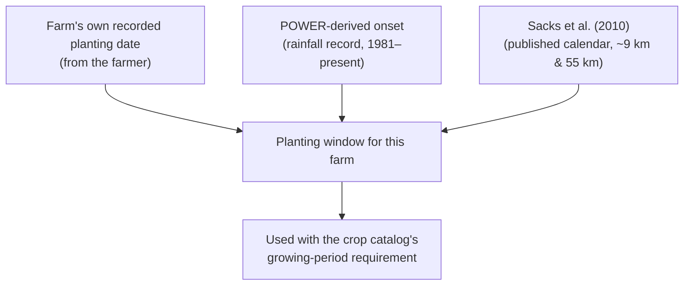

# Crop Calendars and Planting Windows

**Verification date: 2026-11-13.**

This document decides where each planting window in the ruleset comes from.

---

## 1. Why the calendar is the hard part

A crop requirement says *"plant when the soil is warm and the rains have
started"*. Turning that into an actionable statement requires three things
the product does not have by default:

1. **When the rains start here** — a local, year-specific fact.
2. **How long the season is** — so the crop can actually mature before the
   rains end.
3. **What the farmer actually does** — the ground truth that overrides
   everything else.

**[Proposed]** No single source provides all three. The product therefore
combines them, and **states which one it used**.

---

## 2. The three sources



### 2.1 Farmer-reported — the ground truth

**[Proposed]** The highest authority, and the one a farmer will trust most. If
the farmer says they planted millet on 12 May, then for *their* farm, 12 May
is the planting date. The platform should use it directly.

**[Proposed]** The onboarding should ask for the planting date of the current
crop, and the platform should **not argue** when it differs from the derived
calendar. Instead, it should note the difference:

> *"You planted on 12 May. The rainfall record for this area usually brings
> the first sustained rains around 20 May, so you were about a week early."*

That is a genuinely useful observation, and it treats the farmer as the
authority.

### 2.2 POWER-derived — the most reproducible

**[Verified]** NASA POWER gives daily precipitation from 1981-01-01. A
rainy-season onset can be derived: the first day of a run of consecutive days
with cumulative rainfall above a threshold, sustained for a number of days.

**[Proposed] The derivation:**

```
onset_day = first day d such that:
  sum(precipitation, d .. d+2) >= 20 mm      # a sustained start, not a single shower
  AND at least 2 of those 3 days exceed 1 mm
  AND no dry spell of >= 10 days follows within 30 days
```

The exact thresholds need calibration against the observed record. **[Open]**

**[Proposed]** Deriving the onset from POWER gives three things for free:

1. **A current-season onset** — has the rains started yet this year?
2. **A climatological onset** — the median onset over the record, and its
   interquartile range. This is the "normal" the current season is compared
   against.
3. **A season-length estimate** — onset to the end of the rains, which is
   what determines whether a crop can mature.

**[Proposed] This is the strongest version of the "rainfall is a regional
figure" message.** The farmer sees *"the first sustained rains usually arrive
between 8 May and 28 May here, and this year they arrived on 3 June — about
two weeks late"* — and understands both the number and its reach.

**[Proposed] Where the power of POWER comes from:** it is 45 years of
consistent, quality-controlled, freely accessible rainfall for every cell,
with no authentication. That combination is what makes a climatology-based
calendar possible in a 48-hour build.

### 2.3 Sacks et al. (2010) — the published reference

**[Verified]** The standard public crop-calendar dataset:

| Property          | Value                                                     |
| ----------------- | --------------------------------------------------------- |
| Institution       | SAGE, University of Wisconsin–Madison                     |
| Crops             | 19                                                        |
| Resolutions       | **5-minute (~9 km)** and **0.5° (~55 km)**                |
| Variables         | `plant.start`, `plant`, `plant.end`, `harvest.start`, `harvest`, `harvest.end`, plus `.range` variants |
| Formats           | netCDF, ArcINFO ASCII, GeoTIFF                             |
| Download          | <https://sage.nelson.wisc.edu/data-and-models/datasets/crop-calendar-dataset> → `https://sage-public-files.s3.amazonaws.com/crop-calendar-dataset/` |
| R helper          | `geodata::crop_calendar_sacks("maize", path = ...)`        |
| Licence           | CC BY 4.0 per the OasisHUB mirror — **verify**            |
| Courtesy request  | *"If you download this dataset, please email Bill Sacks at wsacks@gmail.com."* |

**[Verified] Citation:**

> Sacks, W.J., Deryng, D., Foley, J.A. & Ramankutty, N. (2010). Crop planting
> dates: an analysis of global patterns. *Global Ecology and Biogeography*
> 19:607–620. doi:10.1111/j.1466-8238.2010.00551.x

**[UNVERIFIED] Nigeria coverage.** The dataset's readme publishes regional
observation counts (e.g. Yams 13 regions at 92 % coverage) but **no
Nigeria-specific figure**. Blank cells are common where a crop has no
observations or is not grown.

**Action required:** download the netCDF and check for non-null `plant.start`
at 12 °N / 8.5 °E for the crops in our catalog, before relying on it.

**[Proposed]** A 9 km Sacks cell is comparable in scale to SMAP. Useful as a
cross-check on the POWER derivation, and better where the crop is specifically
documented.

---

## 3. Other calendars considered

| Dataset                | What it is                                              | Status                       | Verdict |
| ---------------------- | ------------------------------------------------------- | ---------------------------- | ------- |
| **MIRCA2000**          | 26 crops, **irrigated vs rainfed** distinction, monthly planting/harvest, ~2000 baseline | Current public download URL **UNVERIFIED** | Good coverage in Africa but temporally coarse. **Worth checking.** The irrigated/rainfed split matches how farmers think. |
| **IIASA agro-climatic calendars** | —          | **UNVERIFIED** — could not reach or confirm a public dataset | Research lead only, not an integration target |
| **GCPE (Global Crop Phenology)**    | *Agro-climatically estimated* calendars for areas where cropland does not yet exist | **UNVERIFIED** — public access unconfirmed | Interesting conceptually; not needed |
| **CHC / FEWS NET calendars** | Operational crop calendars used in famine monitoring | **UNVERIFIED** | **[Open]** — FEWS NET is an obvious place to look for Sahelian calendars |

**[Open] The most valuable next research step** is probably FEWS NET
(<http://fews.net/>), which publishes crop calendars for the Sahel as part of
its famine monitoring work. **[Open]** Whether it is openly accessible and
citable needs checking. If it is, it would be a better regional reference
than Sacks for northern Nigeria.

---

## 4. How a planting window is decided — the precedence rule

**[Proposed]**

```
1. The farmer's own recorded planting date for this farm
   └─ highest authority, always wins

2. Otherwise, the POWER-derived onset for this cell
   └─ the reproducible, always-available default

3. Cross-checked against Sacks et al. (2010) where coverage exists
   └─ an independent published source

4. Cross-checked against the crop catalog's growing-period requirement
   └─ is there enough time from onset to harvest?
```

**[Proposed]** Every planting window in the product carries its source:

> *"Planting window: derived from the 1981–2025 rainfall record for this
> area."*

> *"Planting window: Sacks et al. (2010)."*

> *"Planting window: as reported by the farmer."*

> *"Planting window: a general reference — not from local practice in your
> area."* ← **when we fall back to a general rule, we say so**

---

## 5. Growing period and the season-length constraint

**[Proposed]** A planting window is only half the answer. The crop must also
be able to **mature** before the rains end.

```
season_length_days = (rainfall_cessation_day) − (rainfall_onset_day)

fits = season_length_days ≥ crop.growingPeriodDays.min
```

**[Proposed]** The crop catalog's `growingPeriodDays` needs a range, not a
point value — a variety's duration varies, and the farmer's own experience
is better evidence than a general range.

**[Proposed] What this produces for a farmer:**

> *"The rains in your area usually last about 110 days, from mid-May to late
> August. Millet usually needs 75–95 days. This year the rains started two
> weeks late, which leaves roughly 95 days — enough for millet if you plant
> now, but short for a longer-duration variety."*

That is actionable, honest, and specific. It is also, note, **not** a yield
prediction.

---

## 6. What we are explicitly not doing

| Not doing                                  | Why                                                     |
| ------------------------------------------ | ------------------------------------------------------- |
| Predicting the best planting date for the current year from the rainfall record alone | Without a forecast, we can only compare the record. Adding a forecast source is a separate decision. |
| Recommending a specific variety            | Needs local variety trial data we do not have          |
| Using a national planting calendar as if it were local | It is regional, and the difference between regions is the whole point |
| Claiming a calendar is validated in Tofa   | It is not, until a farmer says so                       |

---

## 7. Open questions

| # | Question                                                             | Blocking? |
| - | -------------------------------------------------------------------- | --------- |
| 1 | Does the Sacks netCDF have non-null values over Kano for our crops?  | **Yes** for the cross-check |
| 2 | What onset-detection thresholds reproduce the observed historical onsets in Kano? | **Yes** for the derived calendar |
| 3 | Is FEWS NET's Sahelian crop calendar openly accessible and citable?  | No — nice to have |
| 4 | What is the current public download URL for MIRCA2000?               | No |
| 5 | What are the local crop names and varieties in Tofa?                 | **Yes** — the catalog depends on it |

---

## 8. Sources

| URL | Used for |
| --- | -------- |
| <https://sage.nelson.wisc.edu/data-and-models/datasets/crop-calendar-dataset> | Sacks et al. (2010) dataset and terms |
| <https://sage-public-files.s3.amazonaws.com/crop-calendar-dataset/> | File downloads |
| <https://power.larc.nasa.gov/docs/services/api/temporal/daily/> | POWER daily precipitation for onset derivation |
| <https://power.larc.nasa.gov/docs/methodology/> | POWER archive and methodology |
| <http://fews.net/> | FEWS NET crop calendars — **[Open]** |
| <https://data.apps.fao.org/> | FAO data portal — land cover and other FAO products |

All verified **2026-11-13**.
