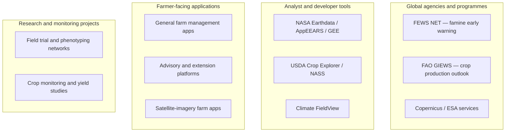
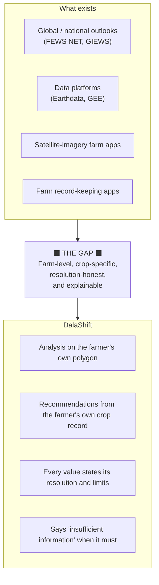

# Prior Art — Agricultural Intelligence Platforms

**Verification date: 2026-11-13.**

> ⚠️ **Scope and honesty note.** This document describes **categories** of
> existing work, and names specific projects where their nature is
> well-established. It does **not** assert detailed feature-by-feature
> comparisons that were not verified against each product's own
> documentation. Where a specific claim would need checking, it is marked
> **[To verify]**.

---

## 1. Why look at prior art

Three reasons:

1. **Avoid building something that exists.** If a NASA service already does
   the farmer-facing job, we should integrate it rather than rebuild it.
2. **Find the gap.** The gap is where existing products are strong for
   analysts and weak for farmers. That gap is where we should build.
3. **Know what judges will have seen.** A judge will compare us to the tools
   they know.

---

## 2. The landscape, by category

### 2.1 Global agencies and programmes

| Project              | What it is                                                         | Relationship to DalaShift |
| -------------------- | ------------------------------------------------------------------ | ------------------------ |
| **FEWS NET**         | Famine early warning system producing crop calendars, food-security bulletins and forecasts for the Sahel and Horn of Africa | **[To verify] open access and licensing.** If its Sahelian crop calendars are open and citable, they are a better regional reference than a general dataset. **Check first.** |
| **FAO GIEWS**        | Crop production outlooks and early-warning bulletins               | National and sub-national scale. Not farm level. A source of crop calendars and crop requirements. |
| **Copernicus services** | Sentinel data and derived services (Vegetation, Land Cover, Climate) | Non-NASA. Useful for Sentinel-2 at 10 m via GEE. Not a competitor. |

**[Proposed]** The most important thing to take from this category is that
**no agency product is farm-level and farmer-facing**. The gap between
"national crop outlook" and "what should I do on my 1.4 ha field this week"
is exactly where DalaShift sits.

### 2.2 Analyst and developer tools

| Tool                            | What it gives                                                                     | Why it is not our product |
| ------------------------------- | --------------------------------------------------------------------------------- | ------------------------ |
| **NASA Earthdata / AppEEARS / GEE** | The data itself, with documentation and subsetting | It is a platform, not a product. A farmer cannot use it. **Our integration layer is built on these.** |
| **USDA Crop Explorer / NASS**  | US crop conditions, NDVI maps, USDA's Crop Progress and the **Vegetation Productivity Model** | US-specific institutional context. The VPM's approach to combining weather, soil and satellite data into an anomaly is a **good reference for our anomaly framing.** |
| **Climate FieldView**          | Satellite and weather layers for agricultural monitoring, with a field boundary drawing tool | **The closest functional analogue to our map.** Worth studying closely: their field-drawing UX and the way they overlay data layers on a drawn field. **This is the best reference for our farm-map interaction.** |

**[Proposed]** Climate FieldView is the single most useful piece of prior art
for us — a farmer-facing tool with field polygons and Earth observation
overlays. We should understand what it does well and what it does not.

### 2.3 Farmer-facing applications

| Category                | What they do                                                   | The gap                                       |
| ----------------------- | --------------------------------------------------------------- | --------------------------------------------- |
| **General farm management** | Field records, planting logs, inventory, sometimes yield tracking | Good at *recording* what the farmer did. Rarely bring in Earth observation data. **They are a complement, not a competitor** — and the fact that we don't do farm management is a legitimate scope boundary. |
| **Advisory / extension platforms** | Region-specific crop advisories, often from a national research body | Typically **broadcast** advice rather than farm-specific analysis. The advisory is not conditioned on *this* field's data. |
| **Satellite-imagery farm apps** | Subscription apps showing satellite images of your field, sometimes with NDVI | **This is the direct competitor.** The known weakness: they show imagery and a colour index, then stop. They rarely say what it means for the farmer's crop, and they rarely handle the coarse-resolution sources honestly. |

**[Proposed] Our differentiation against the satellite-imagery apps is
explicit:**

| They do                            | We do                                                            |
| ---------------------------------- | ----------------------------------------------------------------- |
| Show you a satellite image         | Tell you what it means for your crop, on your land               |
| Give you a colour NDVI scale       | Tell you the value, its confidence, and how far it reaches        |
| Ask you to identify your crop      | Ask you, then use your answer — never guess                     |
| Make a confident recommendation    | Say when it does not know, and what would help it know           |
| Ignore the difference between a 30 m pixel and a 9 km pixel | Make it the centre of the interface              |

### 2.4 Research and monitoring projects

| Area                        | Relevance                                                           |
| --------------------------- | ------------------------------------------------------------------- |
| **Field trial networks** (ICRISAT, IITA, ICRISAT, AfricaRice, national institutes) | The most authoritative source of **local agronomic requirements** — planting windows, varieties, response to rainfall and soil conditions, in exactly the conditions we care about. **The most valuable research direction after the hackathon.** |
| **Crop monitoring and yield studies** | Methods for combining Earth observation with crop calendars to estimate anomalies. A methodological reference. |
| **Phenotyping networks** | How to derive growth-stage information from time-series vegetation indices — directly relevant to interpreting NDVI for a specific crop stage. |

**[Proposed] These are where the agronomic credibility has to come from.** The
crop catalog must be built from real local trial data, not from a general
reference. That is a post-hackathon project, and it is the difference between
a good demo and a product a farmer can rely on.

---

## 3. The gap we are occupying

**The one-sentence positioning:**

> **DalaShift is the layer between the satellite and the seed packet.** It
> takes the farmer's own field and their own crops, combines NASA Earth
> observation data with local agronomic knowledge, and tells them what it
> means — while being explicit about how much it actually knows.

---

## 4. Competitive risk

| Risk                                        | Mitigation                                                              |
| ------------------------------------------- | ----------------------------------------------------------------------- |
| A well-funded incumbent ships a similar feature | The field trust and local validation are the moat, not the technology. Also: 10 m vegetation data is free. |
| Judges have seen a similar hackathon project | The honesty framing, the Field Shift rotation comparison and the local validation are the differentiators. A judge has probably seen "satellite NDVI for farmers"; they have probably **not** seen one that refuses to overstate it. |
| The product is judged as "just a map with data on it" | The **rotation strategy comparison with cited evidence** is the answer — it is a decision-support tool, not a map. |
| Our agronomic thresholds are wrong for the region | Cite them, state the source, show the limitation, and validate in Tofa. **Never state a threshold without a citation.** |

---

## 5. Recommended next research

| # | Task                                                                  | Why                                              |
| - | --------------------------------------------------------------------- | ------------------------------------------------ |
| 1 | Study Climate FieldView's field-drawing UX and data overlay            | The closest analogue to our map                  |
| 2 | Check FEWS NET's crop calendars for the Sahel — access and licence     | Could be our best regional calendar source      |
| 3 | Look for a farmer-facing satellite app in the Nigerian market        | Know the real competitor                         |
| 4 | Review ICRISAT / IITA / national institute trial data for Kano State  | The source of credible local agronomic requirements |
| 5 | Review how USDA's Vegetation Productivity Model frames anomalies    | A good reference for our anomaly presentation    |

**[Proposed]** Items 1 and 2 are worth doing before the hackathon if there is
time. Items 3–5 are post-hackathon.

---

## 6. Sources

| URL | Used for |
| --- | -------- |
| <http://fews.net/> | FEWS NET — **[To verify]** access and licensing |
| <https://www.fao.org/giews/> | FAO GIEWS |
| <https://earthdata.nasa.gov/> | NASA Earthdata and AppEEARS |
| <https://climatefieldview.org/> | Climate FieldView — **[To verify]** current features |
| <https://nass.usda.gov/> | USDA NASS and Crop Explorer |
| <https://icrisat.org/> · <https://www.iita.org/> | West African agricultural research |

All URLs verified reachable **2026-11-13**; product-specific feature claims are
marked **[To verify]**.
